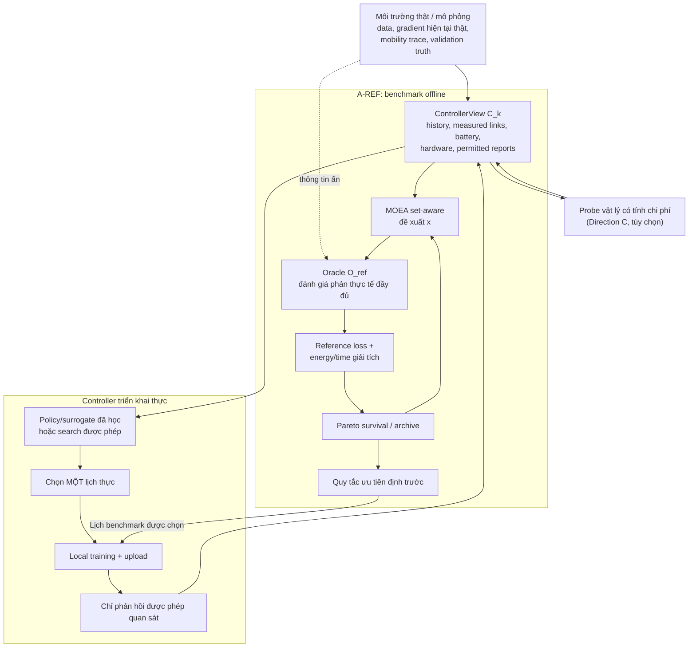

# Triển khai Direction A: Tối ưu hóa tiến hóa đa mục tiêu có xét quan hệ giữa các tập client cho Federated Learning hỗ trợ UAV

> **Bản dịch tiếng Việt của báo cáo Deep Research:** *Implementing Direction A: Set-Aware Multiobjective Evolutionary Optimization for UAV-Assisted Federated Learning*  
> **Tài liệu phân tích:** bản research working draft *Information-Aware Multiobjective Evolutionary Optimization with Multi-Fidelity Evaluation for UAV-Assisted Federated Learning*.  
> **Quy ước:** Giữ ký hiệu, công thức và tên thuật toán bằng tiếng Anh để thuận tiện đối chiếu. `[Sxx]` trỏ đến danh mục URL **ở cuối tài liệu**. Các kiến nghị trong báo cáo **không đồng nghĩa với những điều đã được chứng minh trong draft**.  
> **Phạm vi:** Direction A là trọng tâm; Direction B và C chỉ được nhắc ở những chỗ cần làm rõ ranh giới kỹ thuật.

## 1. Tóm tắt điều hành

Direction A có tiềm năng trở thành một **benchmark lập lịch đa mục tiêu được đánh giá tham chiếu theo cách offline** (*offline, reference-evaluated multiobjective scheduling benchmark*), nhưng hiện **chưa phải một thuật toán trực tuyến có thể triển khai đầy đủ**. Bản draft phân biệt đúng giá trị của một *tập client*, chi phí tài nguyên truyền thông, đánh giá tham chiếu và trạng thái thông tin quan sát không đầy đủ. Tuy nhiên, một số giao diện giữa các thành phần vẫn chưa được định nghĩa chặt chẽ về toán học.

Vấn đề quan trọng nhất: **Algorithm 1 nhiều lần dùng bộ đánh giá tham chiếu (reference evaluator) để quyết định cá thể nào sống sót qua quá trình tiến hóa**. Điều này phù hợp với một benchmark offline có hỗ trợ oracle. Nhưng bộ điều khiển online thực không thể miễn phí huấn luyện và kiểm thử hàng loạt các tập client phản thực tế (*counterfactual client sets*). Draft đã nhận ra sự khác biệt này; cần chuẩn hóa ranh giới đó trong mô hình và code.

Vì vậy, nên xây dựng rõ hai chế độ:

$$
\boxed{\text{A-REF: Bộ tối ưu offline sử dụng đánh giá tham chiếu}}
$$

và về sau:

$$
\boxed{\text{A-DEPLOY: Bộ điều khiển chỉ chọn một lịch từ thông tin được phép}}
$$

**A-DEPLOY không được gọi oracle tham chiếu trong quá trình tìm kiếm.** Nếu thay những lời gọi oracle bằng mô hình dự đoán học được (*surrogate*) thì phương pháp trên thực tế đã chuyển sang Direction B.

Vấn đề thứ hai liên quan đến **tính tách biệt của mục tiêu học (set-level separability)**. Với cùng checkpoint, cùng ngẫu nhiên trong huấn luyện cục bộ, tải lên thành công và gộp trọng số chính xác, hai lịch có **cùng tập client được chọn** $S$ nhưng khác băng thông, CPU hay UAV phục vụ vẫn tạo ra **cùng mô hình toàn cục ở round kế tiếp**. Do đó, mất mát trên validation chỉ cần được đánh giá một lần cho mỗi bộ `(snapshot, S, seed)`; năng lượng và độ trễ vẫn được tính riêng cho từng cấu hình tài nguyên. Nếu hiểu Algorithm 1 như mỗi chromosome đều phải chạy lại toàn bộ học và đánh giá, ta sẽ lãng phí rất nhiều lần đánh giá tốn kém. Kết quả này cũng khiến động lực áp dụng Direction B vào một benchmark một round có cache trở nên yếu đi, trừ khi xét nhánh nhiều round hoặc validation thật sự đắt đỏ.

Vấn đề thứ ba là proxy cho tính bổ trợ (*complementarity*). Draft đưa ra $\hat D(S)$ tính từ những gradient sketch được phép sử dụng, nhưng không định nghĩa đầy đủ cách tính khi sketch **cũ, thiếu, nhiễu hoặc chỉ có ở một số client**. Biểu thức

$$
D(S)=\left\|\sum_{m\in S}\alpha_m(S)g_m-\bar g\right\|^2,
\qquad \bar g=\sum_m p_m g_m
$$

cần gradient tổng thể $\bar g$, trong khi controller thật thường không thể biết gradient hiện tại của tất cả client. DELTA đã phải xây dựng phiên bản dùng thông tin không đầy đủ vì nguyên tắc chọn client lý tưởng cũng phụ thuộc vào thông tin toàn bộ client vốn không có sẵn [S05].

Vấn đề thứ tư là $D(S)$ chỉ đo **mức độ khớp gradient** (*gradient matching*), không phải surrogate đã được chứng minh cho **validation loss sau nhiều bước local SGD**. Với dữ liệu không IID, các client có thể bị *client drift*, như lý thuyết SCAFFOLD và local SGD chỉ ra [S06], [S07]. Ta có thể thiết lập kết quả toán học sạch sẽ cho một bước cập nhật hoặc cho sai lệch trong không gian update, nhưng phải kiểm nghiệm thực nghiệm trước khi xem guided mutation là đóng góp đủ mạnh.

Cuối cùng, mô hình hiện tại có hai tính chất hữu ích:

- Theo mô hình uplink Shannon và năng lượng phát cố định, **để thừa băng thông ở một UAV đang phục vụ client là không hiệu quả theo Pareto** nếu không tính thêm chi phí sử dụng phổ.
- Theo mô hình năng lượng CPU động, công thức chọn tần số CPU nhỏ nhất để đáp ứng một hạn hoàn thành pha không chỉ là heuristic: có thể chứng minh đây là lựa chọn tiêu thụ ít năng lượng nhất trong lớp nghiệm có cùng hạn thời gian.

Do đó, thứ tự triển khai khoa học nên là:

$$
\text{Benchmark exact có giới hạn}
\longrightarrow \text{NSGA-II thông thường}
\longrightarrow \text{NSGA-II set-aware}
\longrightarrow \text{Rút gọn tài nguyên bằng nghiệm giải tích}
\longrightarrow \text{Kiểm tra mobility/channel}
\longrightarrow \text{Thí nghiệm nhiều round}.
$$

Chỉ khi các bước này ổn định mới nên đưa surrogate, multi-fidelity hoặc probing vào nghiên cứu.

## 2. Mô hình hình thức và kiểm toán các khoảng trống lý thuyết

Bảng dưới đây là các khoảng trống cần giải quyết trước khi xem Direction A như một phương pháp có định nghĩa toán học đủ chặt. **P0** là chặn triển khai/claim, **P1** là vấn đề quan trọng, **P2** là vấn đề phụ nhưng cần ghi rõ.

| Mức | Khoảng trống / giả định chưa phát biểu | Vì sao quan trọng | Cách hoàn thiện đề xuất |
|---|---|---|---|
| **P0** | **Algorithm 1 sử dụng reference evaluation, nhưng bài cũng thảo luận về controller triển khai thực.** | Nhiều lần đánh giá lịch phản thực tế có thể truy cập trạng thái mô phỏng ẩn mà controller online không có. Gọi thuật toán đó là *deployable* sẽ vi phạm ranh giới thông tin của chính draft. | Định nghĩa bộ thông tin $\mathcal F_k^{\rm ctrl}=\sigma(\mathcal H_k,\text{measured links},\text{hardware},\text{internal RNG})$. Các hành động sinh lịch phải đo được theo bộ thông tin này. Oracle $\mathcal O_k^{\rm ref}(x)$ chỉ dùng trong **A-REF**; nêu rõ A-REF là benchmark offline. |
| **P0** | **Learning loss bị gắn dư thừa vào toàn bộ $x=(s,b,f)$.** | Khi thỏa giả định cơ sở, $b,f$ và UAV assignment thay đổi thời gian/năng lượng, không làm thay đổi local update của tập $S$. Đánh giá loss cho từng cấu hình tài nguyên rất lãng phí. | Bổ sung mệnh đề *set-loss separability*: với snapshot/seed cố định và gộp đúng, $L_{\rm val}(w_{k+1})=\ell_k(S)$; cache theo `(k,S,ω)` thay vì cả chromosome. |
| **P0** | **$\hat D(S)$ chưa có định nghĩa đủ để tính.** | Eq. (35) không thể triển khai từ sketch thiếu/cũ nếu chưa chỉ ra cách suy diễn client không có sketch và gradient quần thể. | Định nghĩa $r_m=Rg_m+\epsilon_m$, kỳ vọng tiên đoán $\mu_m$, hiệp phương sai $\Sigma_m$; sử dụng expected projected mismatch ở Mục 3.3. |
| **P0** | **Chưa có định lý nối $D(S)$ với validation loss.** | Toán tử *set-aware* dựa trên một proxy nhưng quan hệ với mục tiêu thật chưa được xác lập. Nhiều bước local SGD càng làm quan hệ yếu đi. | Đưa vào bổ đề Lipschitz cho một bước; với FL nhiều bước, cân nhắc $D_\Delta(S)$ trong không gian update hoặc công khai gọi gradient matching là heuristic; kiểm định thực nghiệm. |
| **P0** | **Sketch cũ được sử dụng nhưng thiếu mô hình sai số theo độ cũ.** | Gradient đo tại $w_m^{\rm last}$ có thể lệch xa gradient tại $w_k$, ngay cả khi dữ liệu client không thay đổi. FedSteer nghiên cứu trực tiếp vấn đề này [S08]. | Giả định objective local có gradient $L_m$-Lipschitz; dùng $\|\nabla F_m(w_k)-\nabla F_m(w_m^{\rm last})\|\le L_m\|w_k-w_m^{\rm last}\|$ làm biên bất định hoặc loại sketch vượt ngưỡng. |
| **P0** | **Eq. (29) là kỳ vọng nhưng Algorithm 1 chưa quy định ước lượng loss ngẫu nhiên thế nào.** | Một seed SGD chỉ đánh giá một hiện thực, không phải $\mathbb E[L]$; thứ hạng Pareto có thể sai do nhiễu. | Dùng $R_{\rm search}$ seed ghép cặp, $\hat L_R(x)=R^{-1}\sum_r L(x;\omega_r)$; dùng *common random numbers* trong snapshot; kiểm tra archive cuối bằng seed độc lập. |
| **P0** | **Chuẩn hóa trên tập được chọn nhìn chung tạo thiên lệch so với mục tiêu quần thể.** | Ưu tiên có hệ thống vài client có thể tạo quỹ đạo học thiên lệch dù validation có trọng số theo quần thể. Power-of-Choice nghiên cứu trade-off này; DELTA tìm cách lấy mẫu không chệch [S04], [S05]. | Hoặc công bố chủ ý dùng deterministic biased scheduling rồi đo công bằng/hiệu quả quần thể; hoặc lấy mẫu xác suất $q_m>0$ và dùng Horvitz–Thompson $\hat g=\sum_m I_m p_mg_m/q_m$. Không gọi selected-set normalization là unbiased. |
| **P1** | **Biến mức sử dụng băng thông $\gamma_u$ không cần thiết trong radio model cơ sở.** | Tăng chiều tìm kiếm không có ích. | Chứng minh $R(b)$ tăng; nếu UAV đang phục vụ client thì yêu cầu $\sum_m b_{m,u}=B_u$; chỉ dùng lại $\gamma_u$ nếu có chi phí phổ, can nhiễu hoặc coupling khác. |
| **P1** | **Tần số CPU vẫn là gene tiến hóa dù Eq. (33) cho phép loại bớt chiều.** | Chiều liên tục tăng theo số client đang chọn, tốn evaluation. | Chứng minh mệnh đề rút gọn Pareto; tối ưu một biến thời hạn hoàn thành pha $d$, hoặc một vài biến latency, rồi tính $f_m^\star(d)$ giải tích. |
| **P1** | **“Repair deadline/battery” thiếu quy tắc và có vòng phụ thuộc.** | Năng lượng bay phụ thuộc duration; duration phụ thuộc tài nguyên. Repair tuần tự có thể đánh dấu khả thi sai. | Định nghĩa vector residual $g(x)$; repair chỉ các ràng buộc cấu trúc đơn giản, còn deadline/battery phi tuyến phải đánh giá sau khi decode hoàn chỉnh và xử lý bằng constrained dominance. |
| **P1** | **Thiếu cận dưới số học cho băng thông client hoạt động.** | Softmax dương trên lý thuyết nhưng có thể underflow, tạo rate quá nhỏ. | Thêm $b_{\min}>0$, $b_{m,u}\ge b_{\min}s_{m,u}$; cần $|S_u|b_{\min}\le B_u$, hoặc áp đặt rate hiệu dụng tối thiểu. |
| **P1** | **Giả định kênh cố định phụ thuộc duration của từng candidate.** | Lịch dài khiến UAV đi xa nhưng vẫn dùng channel đầu round, có thể đảo thứ tự Pareto và sai feasibility. | Dùng tỷ lệ $\zeta=v_{\max}T/d_0$, suy ra cận sai số kênh; bắt buộc xác minh bằng dynamic-channel khi $\zeta$ lớn. |
| **P1** | **Radio model bỏ qua lỗi gói, coding gap, truyền lại và can nhiễu.** | Effective Shannon rate có thể đánh giá thấp thời gian và năng lượng thực. | Gọi rõ đây là deterministic effective-rate model; extension dùng $R=\eta_{\rm MAC}b\log_2(1+\mathrm{SNR}/\Gamma)$ và quy định outage/retransmission. |
| **P1** | **Downlink, aggregation, backhaul được nhắc nhưng thiếu tham số.** | Cách tính khác nhau có thể đổi Pareto front và cản trở reproduce. | Cố định protocol; xuất bản $D_k^T,D_k^P,R_u^{\rm bh},P_u^{\rm bh},t^{\rm agg}$, mô hình công suất bay và ranh giới hạch toán trong scenario manifest. |
| **P1** | **EA truy vấn lặp lại validation set hữu hạn gây overfitting khi chọn lịch.** | Pareto front tốt có thể do tối ưu thích nghi trên đúng tập validation dùng nhiều lần. | Chia search-validation, audit-validation độc lập và final test không chạm trong tìm kiếm. |
| **P1** | **Pareto tối ưu một round khác tối ưu chính sách nhiều round.** | Lịch tốt ngay bây giờ có thể làm cạn pin hoặc bỏ quên client hiếm về sau. | Gọi Direction A là receding-horizon heuristic, không nhận là tối ưu Eq. (27); thêm kiểm tra lookahead ngắn và full episode. |
| **P2** | **Guided mutation có thể làm mất khám phá.** | Nếu $\hat D$ sai, chỉ nhận swap giảm proxy sẽ mắc kẹt. | Chọn $p_{\rm guided}<1$ và xác suất mutation ngẫu nhiên dương; nêu lập luận reachability cho lịch rời rạc hữu hạn. |
| **P2** | **Giả định scheduler kiểm soát DVFS.** | $f_m$ chỉ là biến điều khiển nếu phần cứng client cho phép thay tần số và số chu kỳ tính toán $C_m$ gần như độc lập tần số. | Nêu giả định phần cứng DVFS, đo $C_m,\kappa_m,f_m^{\min},f_m^{\max}$; nếu không, coi $f_m$ là thuộc tính cố định. |

Các vấn đề này phát sinh tại các giao diện trong Mục 2–6 của draft. Draft đã cảnh báo nhiều điểm: gradient matching chỉ là proxy; chuẩn hóa selected-set không tự động unbiased; reference oracle và thông tin controller cần tách biệt; channel freezing cần kiểm chứng; Direction A gần đúng ở cấp round chứ không bảo đảm tối ưu toàn horizon.

## 3. Các bổ đề và kết quả toán học nên bổ sung

### 3.1. Tính tách biệt của mục tiêu học theo tập client

**Mệnh đề đề xuất.** Cho tập client được chọn $S$ tại checkpoint cố định $w_k$. Giả sử cập nhật local $\Delta_m^k(w_k,\omega_m)$ phụ thuộc dữ liệu, hyperparameter, checkpoint và seed, **không phụ thuộc** vào UAV association $a$, băng thông $b$, tần số CPU $f$; tất cả upload thành công; aggregation hai tầng thực hiện chính xác trọng số của Eq. (7). Khi đó:

$$
w_{k+1}(S)=w_k+\sum_{m\in S}\frac{p_m}{P_S}\Delta_m^k,
\qquad P_S=\sum_{j\in S}p_j.
$$

Với hai lịch $x_1,x_2$ có cùng $S$:

$$
L_{\rm val}(w_{k+1}(x_1))=L_{\rm val}(w_{k+1}(x_2)).
$$

Suy ra:

$$\boxed{J_L(x)=J_L(S).}$$

**Hệ quả:** cache reference loss theo *tập* thay vì toàn chromosome. Mệnh đề không còn đúng nếu tài nguyên tác động đến xác suất lỗi gói, lượng công việc local, dropout, quantization hoặc trọng số aggregation. Draft có đề cập cache local update ở Mục 5.3 nhưng chưa phát biểu tính tách biệt dưới dạng mệnh đề riêng.

### 3.2. Chính xác thì $D(S)$ bảo đảm điều gì?

Với một bước gradient cập nhật, đặt:

$$
g_S=\sum_{m\in S}\alpha_m(S)g_m,
\qquad \bar g=\sum_mp_mg_m,
$$

$$
w_S^+=w-\eta g_S,
\qquad w_{\rm all}^+=w-\eta\bar g.
$$

Nếu $L_{\rm val}$ là $G_v$-Lipschitz theo tham số trên đoạn nối hai mô hình thì:

$$
\begin{aligned}
|L_{\rm val}(w_S^+)-L_{\rm val}(w_{\rm all}^+)|
&\le G_v\|w_S^+-w_{\rm all}^+\|\\
&=G_v\eta\|g_S-\bar g\|\\
&=\boxed{G_v\eta\sqrt{D(S)}}.
\end{aligned}
$$

Đây là kết luận **có điều kiện và giới hạn**: $D(S)$ nhỏ nghĩa là update một bước của tập $S$ gần update dùng toàn quần thể. Nó **không** chứng minh rằng $D(S)$ nhỏ hơn luôn cho validation loss thấp hơn, cũng không tự động áp dụng sau $I>1$ local SGD steps có dị biệt dữ liệu [S06].

Với thuật toán thực sự có nhiều local steps, proxy tự nhiên hơn là sai lệch giữa **local updates**:

$$
D_\Delta(S)=\left\|
\sum_{m\in S}\alpha_m(S)\Delta_m-\sum_m p_m\Delta_m
\right\|^2.
$$

Khi thỏa điều kiện Lipschitz tương tự:

$$
|L_{\rm val}(w+\Delta_S)-L_{\rm val}(w+\Delta_{\rm all})|
\le G_v\sqrt{D_\Delta(S)}.
$$

Tất nhiên controller triển khai thật không có $\Delta_m$ *hiện tại* của các client chưa chọn. Vì vậy $D_\Delta$ phù hợp làm **chẩn đoán oracle offline** để kiểm tra giá trị của gradient sketch hơn là điểm số online có sẵn.

### 3.3. Định nghĩa $\hat D$ khi chỉ có thông tin không đầy đủ

Xét sketch dự đoán/hiện tại của client $m$ là vector ngẫu nhiên:

$$
r_m=Rg_m+\epsilon_m,
\qquad r_m\mid\mathcal H_k\sim(\mu_m,\Sigma_m).
$$

Đặt hệ số:

$$
c_m(S)=\frac{p_m\mathbf1[m\in S]}{P_S}-p_m.
$$

Sai lệch gradient quần thể sau phép chiếu là:

$$e_R(S)=\sum_m c_m(S)r_m.$$

Một điểm số set-aware được định nghĩa rõ ràng có thể là:

$$
\boxed{\hat D_B(S)=\mathbb E[\|e_R(S)\|^2\mid\mathcal H_k]}.
$$

Nếu dự đoán giữa các client độc lập có điều kiện, biểu thức trở thành:

$$
\boxed{
\hat D_B(S)=
\left\|\sum_m c_m(S)\mu_m\right\|^2
+\sum_m c_m(S)^2\operatorname{tr}(\Sigma_m)
}.
$$

Điểm tốt so với câu mô tả chung “tính $\hat D$ từ permitted sketches” là: sketch mới có covariance nhỏ, sketch cũ/thiếu có độ bất định lớn hơn, và ta không lén đưa gradient hiện tại ẩn của toàn bộ client vào controller. Nếu client có tương quan, cần giữ cả các cross-covariance, không được áp dụng công thức tổng covariance độc lập một cách máy móc.

Đối với sketch mới, không nhiễu, phép chiếu ngẫu nhiên có cơ sở lý thuyết từ Johnson–Lindenstrauss và các cách xây dựng của Achlioptas [S09], [S10]. Với $Q$ vector mismatch cố định, phép chiếu ngẫu nhiên $R$ được chuẩn hóa thích hợp và:

$$
d_s=O\!\left(\epsilon^{-2}\log\frac{Q}{\delta}\right),
$$

có thể đạt, với xác suất ít nhất $1-\delta$:

$$
(1-\epsilon)\|e_S\|^2\le\|Re_S\|^2\le(1+\epsilon)\|e_S\|^2
$$

đồng thời cho một họ hữu hạn các candidate đã cố định. Điều này **chỉ** chứng minh giá trị giảm chiều khi vector gốc hợp lệ, **không** giải quyết vấn đề gradient thiếu/cũ. Nếu candidate được chọn thích nghi theo chính phép chiếu $R$, cần cẩn trọng với điều kiện “họ vector cố định” của bảo đảm.

### 3.4. Biên sai số theo độ cũ của gradient

Nếu $F_m$ có gradient $L_m$-Lipschitz:

$$
\|\nabla F_m(w)-\nabla F_m(v)\|\le L_m\|w-v\|,
$$

thì:

$$
\|g_m(w_k)-g_m(w_m^{\rm last})\|
\le L_m\|w_k-w_m^{\rm last}\|.
$$

Biên này cung cấp một bán kính bất định có ý nghĩa toán học. FedSteer [S08] là tài liệu liên quan trực tiếp vì cho thấy cached/stale gradient của client có thể lệch nhiều và đưa ra biện pháp chỉnh sửa bằng phép chiếu chiều thấp.

### 3.5. Tính đơn điệu của băng thông và sử dụng hết phổ

Viết thông lượng uplink:

$$
R(b)=b\log_2\left(1+\frac{a}{b}\right),
\qquad a=\frac{P_mh_{m,u}}{N_0}>0.
$$

Đạo hàm:

$$
R'(b)=\frac{1}{\ln2}
\left[\ln\left(1+\frac ab\right)-\frac{a}{a+b}\right]>0,
$$

vì $\ln(1+x)>x/(1+x)$ với $x>0$. Do đó:

$$
t_{\rm up}(b)=\frac{L}{R(b)},
\qquad E_{\rm tx}(b)=P\frac{L}{R(b)}
$$

đều giảm khi $b$ tăng. Trong mô hình cơ sở, nếu một UAV còn phổ chưa phân bổ, chuyển thêm phổ cho một link đang hoạt động không làm tệ hơn thời gian hay năng lượng truyền. Vì vậy nghiệm Pareto-efficient có thể chọn thỏa:

$$
\boxed{\sum_{m:a_m=u}b_{m,u}=B_u}
$$

cho mọi UAV đang phục vụ client. Biến hệ số sử dụng $\gamma_u$ nên bằng $1$ trong benchmark cơ sở; nó chỉ có ý nghĩa lại khi phát sinh chi phí phổ/can nhiễu/coupling khác. Kết luận này xuất phát từ **mô hình cụ thể** Eq. (17)/(21), không được khái quát cho mọi hệ thống vô tuyến.

### 3.6. Rút gọn chiều CPU bằng nghiệm giải tích

Giữ association và bandwidth cố định. Đặt:

$$c_m^{\rm tx}=\frac{L_m}{R_m}.$$

Với thời hạn hoàn thành pha $d$:

$$\frac{C_m}{f_m}+c_m^{\rm tx}\le d.$$

Năng lượng tính toán động:

$$E_m^{\rm cmp}=\kappa_m C_m f_m^2$$

**tăng nghiêm ngặt** theo $f_m$, trong khi thời gian tính toán giảm theo $f_m$. Vì thế tần số khả thi tiết kiệm năng lượng nhất là:

$$
f_m^\star(d)=\max\left\{f_m^{\min},\frac{C_m}{d-c_m^{\rm tx}}\right\},
$$

với điều kiện $d>c_m^{\rm tx}$ và $f_m^\star(d)\le f_m^{\max}$. Nếu điều kiện không thỏa thì cấu hình với hạn $d$ **không khả thi**, không phải ép tần số vượt giới hạn.

Lập luận mạnh hơn: với một vector tần số Pareto-efficient $f$, đặt:

$$d=\max_m\left(\frac{C_m}{f_m}+c_m^{\rm tx}\right).$$

Thay tất cả $f_m$ bằng $f_m^\star(d)$ không tăng thời gian pha và không tăng năng lượng, với giảm nghiêm ngặt nếu có một client đang chạy nhanh hơn mức cần thiết. Vậy, trong mô hình năng lượng cơ sở, Eq. (33) thực chất cho phép **rút gọn chiều không gian tìm kiếm**; không chỉ là một bài toán con heuristic. Kết luận phụ thuộc giả định rằng không có công suất tĩnh/động phụ hoặc chi phí khác thay đổi theo thời gian.

### 3.7. Biên sai lệch khi giả định channel cố định trong round

Giả sử client đứng yên trong round, tốc độ UAV tối đa $v_{\max}$, khoảng cách ban đầu $d_0$, độ dài ứng viên $T$. Khi đó:

$$\Delta_q\le v_{\max}T.$$

Với:

$$h(t)=\frac{\beta_0}{d(t)^2}$$

và $\Delta_q<d_0$:

$$d_0-\Delta_q\le d(t)\le d_0+\Delta_q,$$

suy ra:

$$
\left(\frac{d_0}{d_0+\Delta_q}\right)^2
\le\frac{h(t)}{h(\tau_k)}
\le\left(\frac{d_0}{d_0-\Delta_q}\right)^2.
$$

Đặt tỷ lệ mobility không thứ nguyên:

$$\boxed{\zeta=\frac{v_{\max}T}{d_0}.}$$

Đây là một điều kiện có thể diễn giải để đánh giá độ hợp lý của *block/frozen-channel approximation*. UAV dịch chuyển ít so với khoảng cách ban đầu chưa đồng nghĩa sai số gain nhỏ bằng đúng tỷ lệ dịch chuyển, vì gain tỷ lệ nghịch với bình phương khoảng cách. Vì thế phải kiểm tra thực nghiệm thay vì mặc định channel freezing luôn vô hại.

## 4. Thuật toán Direction A chặt chẽ và thiết kế tính toán

Với bản triển khai đầu tiên, nên chọn **NSGA-II có ràng buộc (constrained NSGA-II)** với toán tử pha trộn rời rạc/liên tục, bổ sung cơ chế đề xuất set-aware và bước rút gọn CPU bằng công thức giải tích. NSGA-II là baseline hợp lý vì có *elitist nondominated sorting*, cơ chế duy trì đa dạng nhờ *crowding distance* và nguyên tắc *constraint dominance*. Độ phức tạp sắp xếp không trội điển hình là $O(JN^2)$ với $J$ mục tiêu và kích thước quần thể $N$ [S11].

**MOEA/D** nên là baseline chính tiếp theo vì phân rã tối ưu đa mục tiêu thành các bài toán vô hướng hợp tác, tạo động lực tìm kiếm khác về bản chất với NSGA-II [S12].

Bản thân **Direction A không cần surrogate**. Surrogate phù hợp với Direction B hoặc một controller dùng mô hình xấp xỉ để thay oracle offline. Về sau, Gaussian Process (GP) phù hợp khi số đánh giá ít và cần bất định được hiệu chuẩn; mô hình phân loại quan hệ trội có thể học trực tiếp quan hệ Pareto thay vì dự đoán mọi objective [S29]. Với dữ liệu gồm nhiều tập client/topology khác nhau, các mô hình bất biến đối với hoán vị tập như **Deep Sets** là ứng viên phù hợp vì score không nên phụ thuộc thứ tự liệt kê client [S30]. **Quantile Regression Forest** cung cấp ước lượng phân phối điều kiện thay vì chỉ một dự đoán điểm [S31].

Một lộ trình surrogate cho giai đoạn sau có thể là: **GP** trên đặc trưng tập và mạng cho $n$ nhỏ; **ensemble cây dự đoán quantile/distribution** khi dữ liệu tabular phi tuyến và cần bất định; **DeepSets** khi cần tổng quát sang các tập client hoặc kích thước mạng khác nhau. Đây là gợi ý mở rộng, không phải phần bắt buộc của A.

### 4.1. Cách biểu diễn chromosome

Thay vì tiến hóa tất cả tần số CPU $f_m$, đề xuất:

$$
x=(a_1,\ldots,a_M,\rho_1,\ldots,\rho_M,d),
$$

trong đó:

- $a_m\in\{0,\ldots,U\}$: không chọn client hoặc gán client vào UAV tương ứng;
- $\rho_m$: tham số phân chia băng thông cho client đang hoạt động;
- $d$: hạn hoàn thành pha, từ đó tính các $f_m^\star(d)$ theo công thức giải tích.

Nếu muốn ablation so sánh trước/sau rút gọn chiều CPU, có thể tạm giữ gene $\xi_m\in[0,1]$ như draft.

### 4.2. Pseudocode triển khai A-REF

Phiên bản dưới đây làm rõ ranh giới thông tin, cache theo tập duy nhất, đánh giá ngẫu nhiên và kiểm toán archive:

```text
Thuật toán: Direction A chặt chẽ (A-REF)

Đầu vào:
    C_k              snapshot mà controller được phép thấy
    O_ref            oracle tham chiếu tách biệt
    N                kích thước quần thể
    B_ref            ngân sách đánh giá tập client duy nhất
    Ω_search         tập seed khớp cặp dùng trong tìm kiếm
    Ω_audit          tập seed kiểm toán độc lập
    p_guided         xác suất sử dụng guided mutation

1. Cố định checkpoint nguồn w_k và snapshot_id.
2. Sinh quần thể lịch ban đầu từ:
      các tập khả thi ngẫu nhiên,
      các tập tốt theo channel,
      các tập đại diện dùng permitted sketches,
      nhiều mức cardinality khác nhau.
3. Decode từng candidate.
4. Chỉ repair ràng buộc cấu trúc:
      eligibility/association mask,
      cardinality, bandwidth đơn giản.
5. Tính chính xác bằng mô hình giải tích:
      E(x), T(x), các residual ràng buộc phi tuyến.
6. Với mỗi candidate khả thi:
      key = (snapshot_id, selected_set S, Ω_search)
      nếu key chưa có trong learning_cache:
          đánh giá S bằng O_ref cho tất cả Ω_search
          lưu loss trung bình và mức bất định
      gắn loss đã cache cho các resource variant cùng S.
7. Xếp hạng theo:
      feasibility dominance
      -> Pareto rank
      -> crowding/diversity.
8. Khi còn ngân sách reference cho tập S mới:
      a. Chọn parents.
      b. Chọn mutation rời rạc:
           với p_guided: ComplementarityGuidedSwap
           còn lại: add/drop/random swap/reassign.
      c. Đột biến bandwidth keys.
      d. Decode CPU bằng công thức giải tích.
      e. Tính residual, E và T.
      f. Chỉ gọi reference oracle cho tập S khả thi chưa đánh giá.
      g. Environmental selection.
      h. Cập nhật archive nghiệm khả thi đã kiểm chứng.
9. Đánh giá lại mọi tập không trội dự kiến công bố bằng
   Ω_audit và audit-validation chưa dùng khi tìm kiếm.
10. Tính lại Pareto dominance từ kết quả audit.
11. Chỉ chọn/thực thi một lịch theo quy tắc ưu tiên E/T
    đã công bố trước thí nghiệm.
```

**Điểm quan trọng:** `O_ref` trong bước 6 không được phép xuất hiện trong API controller thực. Thí nghiệm vì thế là benchmark offline hợp lệ, không phải controller giả lập vô tình đọc được *hidden truth*. Điều này phù hợp với ranh giới trong Mục 5.4 của draft.

### 4.3. Toán tử hoán đổi client theo tính bổ trợ

```text
ComplementarityGuidedSwap(S, {μ_m, Σ_m}, p_m, candidate_count=c)

    P_S = Σ_{m∈S} p_m

    Với mỗi client m, đặt:
       coeff_m(S) = p_m / P_S - p_m    nếu m ∈ S
                  = -p_m              nếu m ∉ S

    Tính điểm proxy:
       D_B(S) = || Σ_m coeff_m(S) μ_m ||²
                + Σ_m coeff_m(S)² tr(Σ_m)
       (đây là xấp xỉ nếu belief giữa client độc lập)

    Lấy mẫu c cặp hoán đổi khả thi (i, j):
       i ∈ S
       j ∉ S
       j có ít nhất một link UAV khả thi

    Với từng cặp:
       S' = S \ {i} ∪ {j}
       cập nhật và tính D_B(S')

    Nếu tồn tại cặp cải thiện D_B:
       trả về cặp tốt nhất hoặc lấy mẫu trong số cặp cải thiện
    Nếu không:
       trả về một swap khả thi ngẫu nhiên
```

Với $K=|S|$, thử hết mọi swap rời rạc một cách thông minh, duy trì tổng set có sẵn, có độ phức tạp:

$$O\left(K(M-K)d_s\right).$$

Nếu chỉ lấy $c$ đề xuất ngẫu nhiên thì giảm còn:

$$O(cd_s).$$

Khi thay client $i$ bằng $j$, **không được quên thay mẫu số chuẩn hóa**:

$$P_{S'}=P_S-p_i+p_j,$$

$$G_{S'}=G_S-p_i\mu_i+p_j\mu_j.$$

Nhờ đó một swap có thể cập nhật trong $O(d_s)$ thay vì quét lại toàn bộ tập.

**Nên để proxy tác động đến việc *đề xuất ứng viên* (proposal generation), không dùng proxy làm quyết định sống sót theo Pareto**. Pareto survival phải dựa trên ba mục tiêu reference loss–energy–time, các constraint và quy tắc archive.

Các tiền lệ cần đối chiếu: **DivFL** dùng facility-location trong không gian gradient và greedy submodular selection để xấp xỉ cập nhật full-client [S01]; **FedCor** dùng GP mô hình tương quan ảnh hưởng của các client [S02]; **DELTA** dùng gradient magnitude/diversity, local variance và thiết kế lấy mẫu không chệch [S05]. Vì vậy không thể xem việc “giá trị client phụ thuộc vào tập” tự nó là phát hiện hoàn toàn mới.

### 4.4. Độ phức tạp tính toán

| Thành phần | Cách triển khai đề xuất | Độ phức tạp gần đúng |
|---|---|---:|
| Decode association | Quét chromosome | $O(M)$ |
| Decode bandwidth | Chuẩn hóa theo từng UAV | $O(M+U)$ |
| Decode CPU giải tích | Eq. (33) cho client hoạt động | $O(K)$ |
| Tính energy/time | Tổng theo link và lấy max | $O(K+U)$ |
| Guided mutation với $c$ swap ngẫu nhiên | Cập nhật điểm sketch tăng dần | $O(cd_s)$ |
| Guided mutation vét cạn swap | Mọi cặp $i\in S,j\notin S$ | $O(K(M-K)d_s)$ |
| Sắp xếp NSGA-II | $J=3$ objectives | $O(JN^2)$ mỗi thế hệ [S11] |
| Cập nhật lân cận MOEA/D | Kích thước lân cận $T_n$ | Khoảng $O(JNT_n)$ chưa tính objective evaluation |
| Reference local update không cache | Local SGD client được chọn | Xấp xỉ $O(\sum_{m\in S}C_m^{\rm train})$ |
| Cache lazy cho client updates | Chỉ huấn luyện phần client/seed chưa có | Phụ thuộc số cache miss |
| Aggregation từ cached updates | $d$ tham số model | $O(Kd)$ |
| Full validation | $n_v$ validation samples | $O(n_vC_{\rm forward})$ |
| Thêm nghiệm vào archive kiểu đơn giản | Archive có $A$ nghiệm | $O(JA)$ mỗi candidate |

Draft đã mô tả việc cache reference local updates để tăng tốc đánh giá một snapshot. Nên thực hiện **lazy cache**: chỉ chạy local training của một client dưới seed tham chiếu khi có tập cần dùng client đó lần đầu; không bắt buộc precompute tất cả $M$ client. **Thời gian xây dựng cache vẫn phải ghi trong chi phí tìm kiếm**. Khi mọi $\Delta_m$ cần thiết đã có, các resource variant cùng $S$ không được huấn luyện lại.

Với pilot **6 client và 2 UAV**:

$$2^6-1=63$$

tập client khác rỗng nếu allocator/association dùng cùng một quy tắc cố định. Nếu duyệt cả gán UAV và cho mỗi client ba trạng thái “không chọn / UAV 1 / UAV 2”, không gian association rời rạc ban đầu là:

$$(2+1)^6-1=728$$

assignment không rỗng trước khi lọc feasibility. Đây là benchmark *exact restricted enumeration* rất hữu ích để bắt lỗi archive, mutation, repair, dominance. Tuy nhiên **không phải nghiệm exact của bài toán tài nguyên liên tục**.

## 5. Kiến trúc simulator và quy trình offline/triển khai

Điểm thiết kế phần mềm cốt lõi: **`ControllerView` và `SimulatorTruth` phải là hai cấu trúc dữ liệu/ API tách biệt**, chứ không chỉ dựa vào kỷ luật người viết code.



Nguyên tắc bắt buộc:

$$
\boxed{\text{Output của }\mathcal O^{\rm ref}\text{ được phép định hướng A-REF,}\quad
\text{nhưng không được miễn phí đưa vào trạng thái controller online.}}
$$

Online controller dự đoán nhiều counterfactual bằng surrogate thì thuộc Direction B. Nếu controller vật lý xin quan sát mới từ client thì thuộc Direction C. Bảng 2 trong draft phân biệt reference rollout, surrogate prediction, physical probe, executed FL round và cách hạch toán chi phí của chúng.

Ví dụ, **Oort** [S03] dùng thông tin statistical/system utility để chọn participant và đánh giá với hệ thống FL mô phỏng quy mô lớn, nhưng không giả định một server online có thể chạy hàng loạt training round phản thực tế trước khi chọn một lịch.

### 5.1. Mô phỏng channel cố định và channel thay đổi bên trong round

| Thuộc tính | Frozen-channel simulator cơ sở | Intra-round dynamic-channel |
|---|---|---|
| Channel | $h_{m,u}(t)=h_{m,u}(\tau_k)$ cho cả round | $h_{m,u}(t)=h(q_u(t),p_m(t))$ |
| Data rate | Hằng số $R=b\log_2(1+Ph/(N_0b))$ | Thay đổi theo $t$ |
| Thời điểm upload hoàn thành | $t_{\rm up}=L/R$ | Tìm $t_e$ sao cho $\int_{t_s}^{t_e}R(t)dt=L$ |
| Năng lượng phát, $P$ cố định | $PL/R$ | $P(t_e-t_s)$ hoặc $\int P(t)dt$ khi $P$ thay đổi |
| UAV di chuyển lúc upload | Không đưa vào radio calculation | Mô phỏng tường minh |
| Chi phí simulator | Rất thấp | Cao hơn; tích phân hoặc event simulation |
| Feasibility | Có thể đánh giá sai các lịch dài/nhiều chuyển động | Chính xác hơn về mặt chuyển động |
| Rủi ro Pareto ranking | Sai số mô hình phụ thuộc candidate | Hợp lý hơn khi stress-test mobility |
| Reproducibility | Cao | Cần quy tắc bước thời gian/sai số tích phân |
| Vai trò | Debug, ablation chính | Kiểm chứng vật lý và stress test |
| Điều kiện chấp nhận | Chỉ dùng sau khi chứng minh sai số nhỏ ở vùng mobility quan tâm | Mô hình tham chiếu vật lý mạnh hơn |

Với dynamic-channel, không nên tùy tiện nói “cứ cập nhật $h$ mỗi 10 ms” nếu không công bố bước tích phân đó. Nên dùng event-driven simulation hoặc độ dung sai tích phân cố định. Tài nguyên có thể giữ nguyên trong pha upload còn tốc độ vẫn thay đổi theo quỹ đạo UAV đã định trước. Thời gian hoàn thành phải giải phương trình:

$$
\int_{t_s}^{t_s+t_{\rm up}}
 b_{m,u}\log_2\left(1+\frac{P_mh_{m,u}(t)}{N_0b_{m,u}}\right)dt=L_m.
$$

Điều này thay đổi **evaluation model**, không nhất thiết tăng tần suất scheduler chọn action.

### 5.2. Vị trí của Direction A so với các nghiên cứu UAV-FL

Một số công trình đã đồng tối ưu UAV placement/trajectory cùng device selection. Paper **IEEE JSAC 2021** [S16] dùng A3C cho lựa chọn thiết bị, vị trí UAV và quản lý tài nguyên trong asynchronous FL nhiều UAV. Một paper **IEEE TWC 2025** [S18] đồng tối ưu quỹ đạo UAV, thiết bị và thiết kế bộ thu phát over-the-air, có xét tính không đồng bộ và lỗi truyền. Một paper khác **IEEE TWC 2025** [S19] sử dụng aggregation phân cấp, phân tích tương quan gradient và tối ưu trajectory, device selection cùng aggregation coefficients.

Những công trình đó hữu ích chính vì draft **chủ ý chọn mô hình chuyển động UAV có quỹ đạo cho trước, không tối ưu trajectory**. Đây phải được diễn đạt như ranh giới bài toán, không nên viết thành ưu thế novelty về tối ưu đường bay.

## 6. Kế hoạch xác minh và thiết kế thực nghiệm

Mục tiêu của giai đoạn đầu **không phải chỉ chứng minh phương pháp đề xuất thắng**; cần kiểm định liệu các giả định làm nền tảng cho phương pháp có đúng hay không.

Đơn vị độc lập trong suy luận thống kê cấp thuật toán nên là **cặp `(scenario, seed)`**, không phải mỗi candidate schedule. Nhiều lịch được thử tại cùng checkpoint chia sẻ dữ liệu, updates, channel và validation records; vì vậy chúng tương quan mạnh.

Với so sánh ghép cặp hai phía, lấy $\alpha=0.05$, power $0.8$, ước lượng sơ bộ:

$$
n\approx\frac{(1.96+0.84)^2}{d_z^2}.
$$

Suy ra khoảng 13 cặp cho effect size $d_z=0.8$, 22 cho $0.6$, 32 cho $0.5$ và 50 cho $0.4$. Do đó “10+ runs” trong draft phù hợp với pilot thăm dò; **30 cặp scenario–seed** là mốc xuất phát tốt hơn cho main study, và 50 cặp nếu hiệu ứng nhỏ.

### 6.1. Các giả thuyết quan trọng và cách kiểm tra

| Giả thuyết / giả định | Thiết kế thí nghiệm | Thống kê | Cỡ mẫu khuyến nghị | Ngưỡng hiệu quả đề xuất công bố trước |
|---|---|---|---|---|
| **Gradient matching dự đoán chất lượng học một round** | 20–30 checkpoint độc lập, mỗi checkpoint 50–100 tập client ở nhiều cardinality/diversity; ghi $D(S)$, $\hat D(S)$, one-step loss và loss thật sau $I$ local steps | Spearman/Kendall trong từng snapshot; hồi quy mixed-effects có snapshot random intercept; bootstrap CI | ≥50 sets/checkpoint; 20–30 checkpoint; xấp xỉ 47 quan sát độc lập để thấy $|\rho|\approx0.4$ theo giả định đơn giản | Median $|\rho|\ge0.4$ nếu muốn guidance mạnh; $|\rho|<0.2$ thì chỉ dùng guidance yếu |
| **Random projection giữ được thứ tự complementarity** | Tính $D$ với gradient đầy đủ offline và $D_R$ với $d_s\in\{16,32,64,128,256,\ldots\}$ | Sai số norm tương đối, Kendall $\tau$, top-$k$ overlap | ≥1.000 tập qua ≥20 snapshots | $\tau\ge0.9$ và median relative mismatch error dưới 10% |
| **Set-aware mutation tăng chất lượng tìm kiếm** | Cùng initialization, seed, allocator, budget: generic NSGA-II so với NSGA-II + guided swap | Paired permutation hoặc Wilcoxon trên audited HV; paired bootstrap CI; hiệu chỉnh Holm nếu thử nhiều budget | 30 paired runs chính; 50 stress | $d_z\ge0.5$ hoặc cải thiện median HV ≥5% tại cùng chi phí |
| **Guidance hữu ích nhờ phụ thuộc tập thay vì điểm từng client** | So sánh $\hat D(S)$-guided với individual-score mutation tại cùng số proposal | HV và tần suất chọn client hiếm/nhiễu | 30 paired runs/scenario | HV/learning tăng ở cùng E/T, không hệ thống chọn thêm client nhiễu |
| **Frozen channel đủ chính xác** | Cùng lịch, so frozen/dynamic ở nhiều tốc độ UAV, độ dài round, khoảng cách; block theo mobility trace | TOST equivalence test cho sai số energy/time; bootstrap ghép cặp; Kendall $\tau$ cho thứ tự; Pareto overlap | ≥30 traces × 50–100 schedules/trace; thống kê theo trace | Sai lệch energy/time nằm trong biên tương đương ±5%; $\tau\ge0.9$ |
| **CPU analytical reduction là exact theo base model** | Instance nhỏ, so $f^\star(d)$ với grid search dày và EA giữ nguyên gene CPU | So dominance xác định đến numerical tolerance | Grid cho 6-client; ≥100 resource cases | Không có counterexample vượt sai số số học |
| **Dùng hết băng thông không bị trội** | Sinh allocation có spectrum thừa, chuyển phần dư cho link active, tính lại $E,T$ | Property test xác định | Hàng nghìn case | Không trường hợp nào $E$ hoặc $T$ xấu đi |
| **Reference-loss separability đúng** | Giữ $S$, đổi UAV association/bandwidth/CPU nhiều lần nhưng vẫn upload thành công | So bằng nhau của $w_{k+1}$ và loss | ≥100 resource configurations cho từng $S$ | Sai lệch tham số gần sai số floating-point; lệch đáng kể báo hiệu resource→learning coupling chưa mô hình |
| **Tối ưu một round không quá myopic trong chế độ mục tiêu** | Với $M=6$, so A một round và lookahead hạn chế 2–3 round hoặc beam search | Terminal loss, energy/time ghép cặp, đồ thị quỹ đạo | ≥30 episode seeds/traces | Nếu normalized episode regret >5–10% ở nhiều kịch bản, phải nhấn mạnh giới hạn receding-horizon |
| **Probe lợi ích lớn hơn chi phí thật** | *Thuộc Direction C*: so no-probe/probe với cùng seed, tính mọi chi phí probe về compute/download/upload/wait | Paired permutation/Wilcoxon trên deployment utility và Pareto metrics | ≥32 cặp nếu $d_z\approx0.5$; tốt hơn 50 | Net utility +5% hoặc Pareto shift có ý nghĩa; nếu không thì không kết luận probing đáng dùng |

**Đặc biệt quan trọng là thí nghiệm gradient-proxy.** DivFL [S01] tạo nền tảng cho selection dựa vào đại diện gradient, DELTA [S05] lý giải vai trò gradient diversity/local variance, nhưng hai nghiên cứu đó **không** chứng minh $D(S)$ chuẩn hóa đúng theo draft sẽ tương quan mạnh với validation loss sau nhiều bước FedAvg trong mạng UAV.

Đối với channel freezing, phải trình bày kết quả theo:

$$\zeta=\frac{vT}{d_0}$$

thay vì chỉ tốc độ UAV. Một UAV chuyển động 10 m/s có thể gần như đứng yên tương đối với đường truyền dài 1 km trong pha ngắn, nhưng rất khác với link 50 m trong một round dài.

### 6.2. Lộ trình quy mô benchmark

| Giai đoạn | Clients/UAVs | Cách tìm kiếm | Mục tiêu chính |
|---|---:|---|---|
| Exact restricted sanity test | $M=6,U=2$ | Enumerate 63 tập client với allocator cố định | Kiểm tra landscape loss và complementarity |
| Association sanity test | $M=6,U=2$ | Tối đa 728 association ban đầu | Kiểm tra association và constraints |
| EA pilot | $M=20,U=2$ | $N=64$; budget 100/250/500/1000 unique sets | Generic versus set-aware |
| Scaling | $M=50,U=3$ | $N=96$–128, 1k–3k unique sets | Khả năng mở rộng |
| Stress | $M=100,U=5$ | $N=128$, 2k–5k unique sets hoặc đối sánh wall time | Độ bền với dị biệt và mobility |
| Episode study | 20–100 clients | Lặp one-round optimizer suốt quỹ đạo FL | Chất lượng cuối cùng, năng lượng, thời gian thực |

Các giá trị ngân sách là **điểm khởi đầu đề xuất**, không phải giá trị do định lý quy định. So sánh chính nên vẽ **audited HV theo tổng chi phí reference evaluation thực tế**, thay vì chỉ final HV sau một số generation tùy chọn.

Ở mức snapshot, dùng hypervolume của các nghiệm được reference-verified, với chuẩn hóa objectives cố định và dominated reference point chung. **IGD** chỉ phù hợp khi có reference front đáng tin; với 6 client, enumeration cho restricted reference front, còn quy mô lớn dùng pooled audited nondominated set phải ghi rõ chỉ là **empirical approximation**.

Ở mức toàn bộ FL episode, không chỉ báo HV. Cần ít nhất: final test loss/accuracy, macro-F1, recall của rare class, tổng energy, elapsed physical time, time/energy-to-target-accuracy, tình trạng cạn pin, deadline violations, inclusion frequency theo nhóm client và optimizer latency.

### 6.3. Các baseline bắt buộc

Các baseline lựa chọn client tối thiểu nên gồm:

- Random/uniform participation;
- Channel-only selection;
- Oort-style utility selection [S03];
- Individual gradient-similarity score;
- Individual gradient-novelty/diversity score;
- Một phương pháp **set-aware thực sự** như DivFL/facility-location [S01].

Về optimizer phải so sánh: random feasible search, NSGA-II generic [S11], MOEA/D [S12], NSGA-II set-aware dùng **cùng biểu diễn và repair**.

Ablation quan trọng:

| Ablation | Điều được cô lập |
|---|---|
| Generic mutation vs guided swap | Giá trị của toán tử tìm kiếm set-aware |
| $\hat D(S)$ set-aware vs điểm độc lập từng client | Tính phụ thuộc tập thật sự |
| Full-gradient diagnostic vs sketch proxy | Sai số do nén thông tin |
| Fresh vs stale sketches | Mức nhạy với tuổi thông tin và model drift |
| $p_{\rm rand}=0$ vs $p_{\rm rand}>0$ | Khả năng thoát hướng dẫn sai |
| Evolved CPU vs analytical $f^\star(d)$ | Hiệu quả rút gọn chiều |
| Frozen vs dynamic channel | Sai lệch mô hình vật lý |
| Search-validation vs independent audit-validation | Overfitting do đánh giá thích nghi |
| One-round vs $H=2,3$ lookahead | Tính myopic |
| Cached vs uncached accounting | Evaluation thực sự đắt đến mức nào |


## 7. Tổng quan tài liệu khoa học được tuyển chọn

Những tài liệu dưới đây được chọn trước hết vì có **phương pháp, giả định hoặc công cụ lý thuyết trực tiếp liên quan** đến Direction A, chứ không chỉ vì cùng nhắc từ khóa *client selection*. Toàn bộ đường dẫn gốc, có thể mở trực tiếp trong Markdown, được tập hợp tại **Mục 10 – Danh mục nguồn tham khảo** ở cuối tài liệu.

### 7.1. Set-aware client selection, complementarity, diversity và partial information

| Công trình | Ý tưởng/phương pháp | Dữ liệu hoặc môi trường | UAV di chuyển? | Giá trị tham khảo trực tiếp cho Direction A |
|---|---|---|---|---|
| **Balakrishnan và cộng sự — DivFL**, *Diverse Client Selection for Federated Learning: Submodularity and Convergence Analysis* (2021) [S01] | Facility-location objective trong không gian gradient; greedy submodular subset selection; phân tích hội tụ | FL tổng hợp và dữ liệu thực trong môi trường non-IID | Không | **Nên đọc đầu tiên**; tiền lệ gần nhất về giá trị phụ thuộc *cả tập client*, thay vì cộng điểm từng client |
| **Tang và cộng sự — FedCor**, CVPR 2022 [S02] | GP mô hình tương quan giữa loss của các client; chọn chủ động nhằm giảm global loss kỳ vọng | Fashion-MNIST, CIFAR-10 | Không | Cho thấy ảnh hưởng giữa client có tính tương quan; hữu ích khi xây dựng $\hat V(S)$ và bất định |
| **Fraboni và cộng sự — Clustered Sampling**, ICML 2021 [S13] | Gom cụm client theo kích thước dữ liệu hoặc model similarity; giảm phương sai aggregation và cải thiện representativeness | FL non-IID và dữ liệu mất cân bằng | Không | Baseline trung gian giữa chấm điểm cá thể và lựa chọn hoàn toàn set-aware |
| **Cho, Wang & Joshi — Power-of-Choice**, AISTATS 2022 [S04] | Thiên lệch chọn client loss cao; phân tích đánh đổi giữa tốc độ hội tụ và bias nghiệm | FL và phân tích lý thuyết | Không | Quan trọng cho vấn đề selected-set normalization và biased client scheduling |
| **Wang và cộng sự — DELTA**, NeurIPS 2023 [S05] | Unbiased sampling dựa gradient diversity và local variance; có phiên bản dùng thông tin không đầy đủ | Synthetic, Fashion-MNIST, CIFAR-10, FEMNIST, CelebA; CNN, ResNet-18 | Không | **Nên đọc đầu tiên** để xử lý gradient diversity, representativeness và thiếu full gradient |
| **Liu và cộng sự — One-Pass Distribution Sketch**, NeurIPS 2023 [S14] | Compact sketch về phân phối dữ liệu; khoảng cách sketch liên hệ với distribution divergence; có xử lý cold start | Các benchmark FL, client mới | Không | Thay thế gradient sketch nếu cần đo complementarity về phân phối dữ liệu |
| **Chen & Vikalo — HiCS-FL**, NeurIPS 2024 [S15] | Ước lượng heterogeneity từ update lớp cuối, clustering phân cấp, phân tích hội tụ | Non-IID FL với các mức dị biệt | Không | Cách thu thông tin giá rẻ hơn full gradient/sketch |
| **Ji và cộng sự — ShapCCS**, ICML 2026 [S21] | Shapley value từ gradient projection, xem cả hướng/độ lớn update; xây coreset và xét negative contribution | FL/noisy-client experiments | Không | So sánh hiện đại cho contribution-based set construction và loại client gây hại |
| **Zhang và cộng sự — FedSteer**, UAI 2026 [S08] | Cached gradient subspace và corrective projections chống gradient quá cũ | FL có skewed participation/staleness cao | Không | **Nên đọc cho stale-sketch gap**; không thể chỉ dùng timestamp rồi coi gradient cũ như mới |
| **Lai và cộng sự — Oort**, OSDI 2021 [S03] | Utility-guided participant selection cân bằng statistical value, system speed và exploration | Google Speech, OpenImage, StackOverflow, Reddit, heterogeneous mobile/network traces | Không | Baseline hệ thống quan trọng, phối hợp learning value với năng lực tính toán/truyền thông |

Oort xây dựng thử nghiệm với các bộ dữ liệu Google Speech, OpenImage, StackOverflow và Reddit; mô phỏng runtime, throughput/connectivity, heterogeneity mô hình và availability từ dữ liệu/thông tin thực [S03]. Cấu trúc đánh giá đó hữu ích cho phần *systems realism* của benchmark.

DELTA đặc biệt hữu ích cho mặt thống kê: các thí nghiệm bao gồm Fashion-MNIST, CIFAR-10, FEMNIST và CelebA non-IID, cùng thảo luận cụ thể về việc phương pháp lý tưởng đòi hỏi thông tin chưa có [S05].

### 7.2. Tối ưu tiến hóa đa mục tiêu và bài toán lập lịch UAV/wireless

| Công trình | Phương pháp | Bối cảnh | UAV chuyển động? | Đối chiếu với Direction A |
|---|---|---|---|---|
| **Deb và cộng sự — NSGA-II**, IEEE TEC 2002 [S11] | Nondominated sorting, elitism, crowding, constraint dominance | Benchmark tối ưu đa mục tiêu có/không ràng buộc | Không áp dụng | Nền tảng optimizer chính và baseline bắt buộc |
| **Zhang & Li — MOEA/D**, IEEE TEC 2007 [S12] | Phân rã bài toán MOO thành các scalar subproblems | Benchmark MOO tổng quát | Không áp dụng | Baseline MOEA có cơ chế tìm kiếm khác bản chất |
| **Liu và cộng sự — Privacy-Preserving FL for UAV-Enabled Networks**, IEEE JSAC 2021 [S16] | A3C cho joint device selection, UAV placement và resource management trong asynchronous FL | UAV-FL mô phỏng số | Placement được tối ưu; không phải fixed prescribed moving trajectory | Đối chiếu gần nhất về joint client selection + UAV resource decisions |
| **Client Selection for Wireless FL With Data and Latency Heterogeneity**, IEEE IoT-J 2024 [S17] | Convergence upper bound, tối ưu hỗn hợp nguyên cân bằng dị biệt dữ liệu và latency | Wireless FL, thực nghiệm/simulation | Không | So sánh coupling learning–network không có UAV |
| **UAV-Enabled FL in Dynamic Environments**, IEEE TVT 2024 [S20] | Secure UE selection, UAV placement/resource allocation; LSTM-DDPG | Environment động với UE/eavesdropper di chuyển | Có quyết định placement trong dynamic setting | Stress model đối chiếu khi hình học mạng thay đổi |
| **UAV-Enabled Asynchronous FL**, IEEE TWC 2025 [S18] | Phân tích hội tụ; joint trajectory, device selection, AirComp transceiver | UAV asynchronous FL simulation | **Có tối ưu trajectory** | Đối chiếu với fixed prescribed trajectory và frozen-channel của draft |
| **UAV-Enabled Over-the-Air FL: Hierarchical Aggregation**, IEEE TWC 2025 [S19] | Hierarchical aggregation; phân tích gradient correlation; AO/SCA/FP cho trajectory, device selection, aggregation coefficients | Hierarchical wireless FL simulation | **Có tối ưu trajectory** | Rất sát với aggregation phân tầng và tương quan gradient |

Các paper UAV cho thấy cần giữ **ranh giới novelty** rõ: chỉ ghép NSGA-II vào mô hình tài nguyên UAV-FL **khó đủ tính mới**. Nghiên cứu trước đã kết hợp lựa chọn thiết bị, UAV positioning/trajectory, biến truyền thông và learning-related quantities bằng RL, alternating optimization, SCA, fractional programming và nhiều cách khác [S16], [S18], [S19].

Đóng góp dễ bảo vệ hơn cho Direction A là **toán tử thống kê phụ thuộc tập được ghép với một benchmark tài nguyên đa mục tiêu được kiểm soát chặt**, chứ không phải việc sử dụng một evolutionary optimizer nói chung.

### 7.3. Surrogate và multi-fidelity — chỉ để chuẩn bị giao diện Direction B

| Công trình | Phương pháp lõi | Thực nghiệm/bối cảnh | UAV/FL? | Khi nào hữu ích |
|---|---|---|---|---|
| **Daulton, Balandat & Bakshy — qEHVI**, NeurIPS 2020 [S24] | Differentiable parallel expected hypervolume improvement cho constrained multiobjective BO | Synthetic/real black-box optimization | Không | Acquisition baseline khi high-fidelity evaluation đắt |
| **Daulton và cộng sự — qNEHVI**, NeurIPS 2021 [S25] | Noisy expected hypervolume improvement, xử lý bất định front | Noisy MOO | Không | Thích hợp hơn deterministic EHVI khi validation loss có nhiễu |
| **Daulton và cộng sự — Hypervolume Knowledge Gradient**, ICML 2023 [S26] | Decision-theoretic one-step lookahead, decoupled/multi-fidelity MOO | Synthetic và real BO | Không | **Nên đọc cho Direction B**: nên đánh giá candidate/fidelity nào tiếp theo |
| **Fan và cộng sự — iMFBO**, UAI 2024 [S27] | GP với fidelity/reliability phụ thuộc input | Multi-information-source optimization | Không | Reduced FL rollout có thể đúng với một tập nhưng sai với tập khác |
| **Mikkola và cộng sự — Robust MFBO**, AISTATS 2023 [S28] | Bảo vệ BO khỏi low-fidelity information source không đáng tin; có bảo đảm lý thuyết | MFBO benchmarks | Không | Khi ranking theo reduced rollout thường bị đảo |
| **Wu và cộng sự — Practical MFBO**, UAI 2020 [S32] | Trace-aware knowledge gradient; số training steps/subsamples làm fidelity | Deep-network/kernel hyperparameter optimization | Không | Tương tự việc giảm số local SGD steps hoặc validation samples |
| **Classification-Based Surrogate-Assisted EA**, IEEE TEC [S29] | Học quan hệ dominance và bất định thay vì hồi quy mọi objective | Expensive many-objective benchmarks | Không | Direction B có thể cần đúng thứ tự Pareto hơn là đúng giá trị tuyệt đối |
| **Multiple-Surrogate Decomposition EA**, IEEE TEC 2019 [S33] | Nhiều loại surrogate + decomposition + archive/infill | Expensive multi/many-objective benchmarks | Không | Baseline nếu về sau claim một surrogate-assisted MOEA mới |

**Kết luận phạm vi:** Direction A giai đoạn đầu nên là **single-fidelity**. Chỉ sau khi đo profiling xác nhận reference learning evaluation thực sự là bottleneck mới cần triển khai Direction B.

### 7.4. Probing, bất định và giá trị thông tin — để tham khảo Direction C

Công trình chọn client khi không chắc chắn đã có tương đối nhiều; còn framework mà controller **trả giá vật lý để probe**, cập nhật belief, rồi reoptimize lịch ở bước hai và đo *net expected value of sample information (EVSI)* không xuất hiện trực tiếp trong nhóm tài liệu gần nhất đã thu thập. Đó là một động lực nghiên cứu cho Direction C, nhưng muốn khẳng định novelty vẫn phải tiếp tục tổng quan khi chuẩn bị submit.

| Công trình | Phương pháp | Bối cảnh | UAV di chuyển? | Ý nghĩa cho probing / VoI |
|---|---|---|---|---|
| **Goetz và cộng sự — Active Federated Learning**, 2019 [S22] | Nonuniform active client sampling dựa vào thông tin model/client; dùng giao tiếp cho client có giá trị | FL experiments, ít round hơn trong các setting được báo cáo | Không | Tiền lệ sớm về thu nhận participant mang thông tin, chưa phải EVSI probe vật lý có tính phí |
| **FedCor**, CVPR 2022 [S02] | GP uncertainty/correlation cho active selection | Fashion-MNIST/CIFAR-10 | Không | Công cụ belief-based scheduling |
| **FedSUV**, IEEE INFOCOM 2026 [S23] | Tách client validity uncertainty và data-utility uncertainty; contextual bandit + GP bandit | Theory và thử nghiệm cluster; abstract không liệt kê chi tiết dataset | Không | **Rất nên đọc cho Direction C**: so sánh gần về uncertainty-driven client selection |
| **FedSteer**, UAI 2026 [S08] | Sửa cached/stale gradient bằng projection | Extreme staleness | Không | Baseline “sửa thông tin cũ” thay vì luôn probe |
| **One-Pass Distribution Sketch**, NeurIPS 2023 [S14] | Sketch phân phối chi phí thấp và cold-start | Non-IID FL | Không | Quan sát rẻ hơn gradient probing |

Một nghiên cứu Direction C cần so **probe vs no-probe** và cả **probe vs sử dụng history tốt hơn**, như stale-gradient correction, uncertainty-aware scheduling, periodic refresh hoặc cheap distribution sketches. Nếu không, phần cải thiện có thể chỉ do phương pháp đề xuất được cung cấp nhiều thông tin hơn baseline.

## 8. Checklist triển khai và trình tự đọc ưu tiên

Các thông số sau cần được **đóng băng thành scenario specification** trước khi bắt đầu code Direction A.

### 8.1. Đầu vào của scenario

| Nhóm | Trường bắt buộc |
|---|---|
| FL | Model architecture, checkpoint hash, optimizer, learning rate, local steps $I$, batch size, update compression, client datasets, weights đích $p_m$ |
| Chia dữ liệu | Train/search-validation/audit-validation/final-test; IID/Dirichlet parameter; định nghĩa rare client; label-noise specification |
| Client compute | $C_m$, $f_m^{\min}$, $f_m^{\max}$, $\kappa_m$, tùy chọn static power |
| Radio | $P_m$, $N_0$, $B_u$, $b_{\min}$, path-gain model, measured eligibility mask, payload bits |
| UAV | Hàm trajectory $q_u(t)$, độ cao, start time, flight-power trace/model |
| Protocol | Downlink time/energy, backhaul rate, aggregation time/energy, rule xác định upload thành công/thất bại |
| Constraints | $N_{\max}$, $T_{\max}$, battery/reserve states, active-link thresholds |
| Information | Sketch/report được phép mới nhất, timestamp, model version sinh sketch, uncertainty metadata |
| MOEA | $N$, reference budget, xác suất guided/random mutation, crossover/mutation, scale constraint $\sigma_j$ |
| Reproducibility | Scenario ID, partition seed, FL seed, MOEA seed, mobility trace ID, reference seed bundle, software commit, hardware |

Simulator nên cung cấp tối thiểu hai API:

```text
ControllerView get_controller_view(snapshot_id)
ReferenceResult reference_evaluate(snapshot_id, candidate, seed)
```

`ControllerView` **không được** chứa current gradients ẩn của simulator, labels ẩn, future mobility ngoài thông tin đã được phép biết, global validation data hay counterfactual outcomes. Cần unit test cho boundary này, không chỉ tài liệu hóa.

### 8.2. Các trường log mỗi lần evaluation

```text
snapshot_id
checkpoint_hash
candidate_hash
selected_set_hash
association
resource_vector
search_seed
FL/reference_seed
validation_split_id
loss
energy
time
constraint_residuals
channel_mode
reference_cost_seconds
cache_hits/cache_misses
verification_status
```

Nên giữ cấu trúc module draft đề xuất: FL engine, network model, energy model, schedule representation, evaluator, MOEA, belief/probe system và experiments; chúng có nhiệm vụ khác nhau và có thể kiểm thử độc lập.

### 8.3. Ma trận so sánh để có thí nghiệm Direction A đạt chuẩn bài báo

| Phương pháp | Client selection | Resource allocator | Reference budget |
|---|---|---|---|
| Random feasible | Ngẫu nhiên | Allocator chung | Bằng nhau |
| Channel greedy | Theo channel | Allocator chung | Bằng nhau |
| Oort-style | Điểm utility thống kê + hệ thống từng client | Allocator chung | Bằng nhau |
| Individual gradient similarity | Điểm mỗi client | Allocator chung | Bằng nhau |
| Individual gradient diversity | Điểm mỗi client | Allocator chung | Bằng nhau |
| DivFL-style | Set/submodular selector | Allocator chung | Bằng nhau |
| NSGA-II | Generic EA operators | Evolved/analytical resources | Bằng nhau |
| MOEA/D | Generic EA operators | Cùng representation | Bằng nhau |
| **Direction A đề xuất** | Set-aware evolutionary operators | Cùng resource model | Bằng nhau |

Điểm thiết yếu là so các selector bằng **một allocator tài nguyên chung**. Nếu không, cải thiện gán cho complementarity có thể thực chất chỉ nhờ thuật toán chia bandwidth/CPU tốt hơn. Ngược lại, khi đánh giá riêng bộ tối ưu tài nguyên phải giữ tập client $S$ cố định.

Kết quả chính nên là các đường:

$$\text{audited HV}\quad\text{theo}\quad\text{actual cumulative reference cost},$$

và ở cấp FL episode:

$$L_{\rm test}(t),\qquad E_{\rm cumulative}(t),\qquad\text{rare-class recall}(t).$$

Chỉ báo một giá trị final accuracy tốt nhất là không đủ cho bài toán ba mục tiêu learning loss–energy–time.

### 8.4. Thứ tự ưu tiên đọc các paper

**1. Draft gốc** — tập trung Mục 2.2, 4.3, 5.2–5.4, 6, 9 và 10; đây là chỗ định nghĩa những claim mà Direction A cần kiểm chứng. Mọi so sánh với nguồn bên ngoài phải giữ đúng mô hình draft.

**2. DivFL [S01]** — gần nhất về set representativeness trong không gian gradient và việc chuyển mục tiêu đó thành một combinatorial objective. Cần hiểu rõ vì sao $\hat D$-guided EA khác với việc đặt selector DivFL vào MOEA.

**3. DELTA [S05]** — trực tiếp về gradient diversity, redundancy, unbiased sampling và thiếu thông tin full-client. Rất hữu ích để không xây dựng $\hat D$ trên một oracle vô hình.

**4. Oort [S03]** — có giá trị hệ thống khi cân bằng statistical utility với execution speed, đồng thời cho ví dụ về simulator phản ánh heterogeneity của client/mạng.

**5. FedCor [S02]** — cho phép đối chiếu với mô hình correlation giữa các client; rất sát lập luận “client value is set dependent”.

**6. SCAFFOLD [S06]** — phải đọc trước khi cố chứng minh rằng gradient matching tại $w_k$ dự đoán validation sau nhiều bước SGD; nó giải thích vấn đề client drift.

**7. NSGA-II và MOEA/D [S11], [S12]** — giúp xây dựng chuẩn baseline optimizer và không đánh đồng thao tác tiến hóa tiêu chuẩn với đóng góp mới.

**8. Ba paper UAV-FL [S16], [S18], [S19]** — đặt giới hạn những thứ đã có trong joint scheduling/resource allocation, hierarchical aggregation, trajectory và communication.

**9. Chỉ khi đã profiling Direction A:** Hypervolume Knowledge Gradient [S26], qNEHVI [S25], Robust MFBO [S28] và input-dependent MFBO [S27] — để xem việc đánh giá fidelity nào tiếp theo có cơ sở hay không.

## 9. Kết luận và phát biểu nghiên cứu khả dĩ nhất

Câu chuyện lý thuyết khả thi nhất của Direction A nên **hẹp nhưng bảo vệ được**:

$$
\boxed{\begin{array}{c}
\text{Giá trị học của client phụ thuộc vào tập client được chọn}\\
\Downarrow\\
\text{Xây dựng set proxy được định nghĩa toán học và hợp lệ về thông tin}\\
\Downarrow\\
\text{Dùng proxy để định hướng đề xuất ứng viên của tiến hóa}\\
\Downarrow\\
\text{Dùng reference evaluation thống nhất để chọn lọc và kiểm toán}\\
\Downarrow\\
\text{Khảo sát Pareto trade-off giữa loss, năng lượng và thời gian}\\
\Downarrow\\
\text{Xác minh cải thiện tại cùng chi phí đánh giá tham chiếu thực tế}
\end{array}}
$$

Cách phát biểu này tránh bốn sai lầm lớn: coi complementarity proxy là learning objective thật; coi reference oracle là công cụ online miễn phí; bỏ qua tính tách biệt/cache và nghiệm giải tích trong mô hình; tuyên bố thuật toán mới tốt hơn chỉ bằng các kết quả không có cùng budget.

**Giả thuyết nghiên cứu trọng tâm có thể kiểm định** là:

> **Với cùng chi phí đánh giá high-fidelity, các phép đề xuất có xét quan hệ giữa client trong tập có tìm được Pareto front loss–energy–time tốt hơn, sau khi kiểm toán độc lập, so với evolutionary search thông thường và các baseline chọn client đã biết hay không?**

Câu trả lời cần đến từ thí nghiệm cùng điều kiện, không thể coi là đã đúng chỉ từ mô tả của draft.

---

## 10. Danh mục tất cả nguồn tham khảo và liên kết gốc

> **Cách dùng file Markdown:** Các mã `[S01]`–`[S33]` trong báo cáo trỏ về những tài liệu dưới đây. Mỗi tiêu đề là một hyperlink tới trang công bố hoặc bản PDF chính thức được dùng trong báo cáo gốc. Tôi giữ tên tiếng Anh để bạn dễ tìm DOI, BibTeX và code trên trang publisher. Những nguồn không có DOI được xác nhận trong report được liên kết bằng URL gốc, **không tự tạo DOI**.
>
> **Nguồn nội bộ [D00]:** *Information-Aware Multiobjective Evolutionary Optimization with Multi-Fidelity Evaluation for UAV-Assisted Federated Learning*, working draft PDF do bạn cung cấp. Đây là file nội bộ; báo cáo gốc không cung cấp URL công khai nên không gắn đường dẫn giả.

### 10.1. FL client selection, diversity và lý thuyết thống kê

- **[S01] Balakrishnan et al. (2021), DivFL — *Diverse Client Selection for Federated Learning: Submodularity and Convergence Analysis*.** [PDF nghiên cứu gốc](https://fl-icml.github.io/2021/papers/FL-ICML21_paper_67.pdf)  
  URL: https://fl-icml.github.io/2021/papers/FL-ICML21_paper_67.pdf

- **[S02] Tang et al. (2022), FedCor — *Correlation-Based Active Client Selection Strategy for Heterogeneous Federated Learning*. CVPR.** [Trang paper chính thức](https://openaccess.thecvf.com/content/CVPR2022/html/Tang_FedCor_Correlation-Based_Active_Client_Selection_Strategy_for_Heterogeneous_Federated_Learning_CVPR_2022_paper.html)  
  URL: https://openaccess.thecvf.com/content/CVPR2022/html/Tang_FedCor_Correlation-Based_Active_Client_Selection_Strategy_for_Heterogeneous_Federated_Learning_CVPR_2022_paper.html

- **[S03] Lai et al. (2021), Oort — *Oort: Efficient Federated Learning via Guided Participant Selection*. OSDI.** [Trang USENIX](https://www.usenix.org/conference/osdi21/presentation/lai) · [PDF](https://www.usenix.org/system/files/osdi21-lai.pdf)  
  URL: https://www.usenix.org/conference/osdi21/presentation/lai

- **[S04] Cho, Wang & Joshi (2022), Power-of-Choice — *Towards Understanding Biased Client Selection in Federated Learning*. AISTATS.** [PMLR](https://proceedings.mlr.press/v151/jee-cho22a.html)  
  URL: https://proceedings.mlr.press/v151/jee-cho22a.html

- **[S05] Wang et al. (2023), DELTA — *DELTA: Diverse Client Sampling for Fast Federated Learning*. NeurIPS.** [Trang chính thức](https://proceedings.neurips.cc/paper_files/paper/2023/hash/949c57d30f8791e3ae42646081b3c102-Abstract-Conference.html) · [PDF](https://proceedings.neurips.cc/paper_files/paper/2023/file/949c57d30f8791e3ae42646081b3c102-Paper-Conference.pdf)  
  URL: https://proceedings.neurips.cc/paper_files/paper/2023/hash/949c57d30f8791e3ae42646081b3c102-Abstract-Conference.html

- **[S06] Karimireddy et al. (2020), SCAFFOLD — *SCAFFOLD: Stochastic Controlled Averaging for Federated Learning*. ICML.** [PMLR](https://proceedings.mlr.press/v119/karimireddy20a.html)  
  URL: https://proceedings.mlr.press/v119/karimireddy20a.html

- **[S07] Patel et al. (2024), *The Limits and Potentials of Local SGD for Distributed Heterogeneous Learning with Intermittent Communication*.** [PMLR](https://proceedings.mlr.press/v247/patel24a.html)  
  URL: https://proceedings.mlr.press/v247/patel24a.html

- **[S08] Zhang et al. (2026), FedSteer — *FedSteer: Taming Extreme Gradient Staleness in Federated Learning with Corrective Projections and Caching*. UAI.** [PMLR](https://proceedings.mlr.press/v337/zhang26d.html)  
  URL: https://proceedings.mlr.press/v337/zhang26d.html

- **[S09] *The Johnson-Lindenstrauss lemma and the sphericity of some graphs*.** [Bài nghiên cứu được report liên kết](https://www.sciencedirect.com/science/article/pii/0095895688900433)  
  URL: https://www.sciencedirect.com/science/article/pii/0095895688900433

- **[S10] Achlioptas (2003), *Database-Friendly Random Projections: Johnson–Lindenstrauss with Binary Coins*.** [Journal of Computer and System Sciences](https://www.sciencedirect.com/science/article/pii/S0022000003000254)  
  URL: https://www.sciencedirect.com/science/article/pii/S0022000003000254

- **[S13] Fraboni et al. (2021), *Clustered Sampling: Low-Variance and Improved Representativity for Clients Selection in Federated Learning*. ICML.** [PMLR](https://proceedings.mlr.press/v139/fraboni21a.html)  
  URL: https://proceedings.mlr.press/v139/fraboni21a.html

- **[S14] Liu et al. (2023), *One-Pass Distribution Sketch for Measuring Data Heterogeneity in Federated Learning*. NeurIPS.** [Trang chính thức](https://proceedings.neurips.cc/paper_files/paper/2023/hash/32c2f3e0a44d55820da7fbcee0a1d95c-Abstract-Conference.html)  
  URL: https://proceedings.neurips.cc/paper_files/paper/2023/hash/32c2f3e0a44d55820da7fbcee0a1d95c-Abstract-Conference.html

- **[S15] Chen & Vikalo (2024), HiCS-FL — *Heterogeneity-Guided Client Sampling: Towards Fast and Efficient Non-IID Federated Learning*. NeurIPS.** [Trang chính thức](https://proceedings.neurips.cc/paper_files/paper/2024/hash/7886b9bafe76c52fd568db10ff9772df-Abstract-Conference.html)  
  URL: https://proceedings.neurips.cc/paper_files/paper/2024/hash/7886b9bafe76c52fd568db10ff9772df-Abstract-Conference.html

- **[S21] Ji et al. (2026), ShapCCS — *ShapCCS: Shapley-Driven Client Coreset Selection in Federated Learning*. ICML.** [PMLR](https://proceedings.mlr.press/v306/ji26b.html)  
  URL: https://proceedings.mlr.press/v306/ji26b.html

- **[S22] Goetz et al. (2019), *Active Federated Learning*.** [arXiv](https://arxiv.org/abs/1909.12641)  
  URL: https://arxiv.org/abs/1909.12641

- **[S23] *FedSUV: Validity and Utility-guided Client Selection for Federated Learning*. INFOCOM 2026.** [IEEE Xplore](https://ieeexplore.ieee.org/abstract/document/11571211)  
  URL: https://ieeexplore.ieee.org/abstract/document/11571211

### 10.2. Multiobjective optimization và UAV/wireless FL

- **[S11] Deb et al. (2002), *A Fast and Elitist Multiobjective Genetic Algorithm: NSGA-II*. IEEE Transactions on Evolutionary Computation.** [IEEE Xplore](https://ieeexplore.ieee.org/document/996017)  
  URL: https://ieeexplore.ieee.org/document/996017

- **[S12] Zhang & Li (2007), *MOEA/D: A Multiobjective Evolutionary Algorithm Based on Decomposition*. IEEE Transactions on Evolutionary Computation.** [IEEE Xplore](https://ieeexplore.ieee.org/document/4358754)  
  URL: https://ieeexplore.ieee.org/document/4358754

- **[S16] *Privacy-Preserving Federated Learning for UAV-Enabled Networks: Learning-Based Joint Scheduling and Resource Management*. IEEE JSAC, 2021.** [IEEE Xplore](https://ieeexplore.ieee.org/document/9453811/)  
  URL: https://ieeexplore.ieee.org/document/9453811/

- **[S17] *Client Selection for Wireless Federated Learning With Data and Latency Heterogeneity*. IEEE Internet of Things Journal, 2024.** [IEEE Xplore](https://ieeexplore.ieee.org/abstract/document/10589575)  
  URL: https://ieeexplore.ieee.org/abstract/document/10589575

- **[S18] *UAV-Enabled Asynchronous Federated Learning*. IEEE TWC, 2025.** [IEEE Xplore](https://ieeexplore.ieee.org/document/10818523/)  
  URL: https://ieeexplore.ieee.org/document/10818523/

- **[S19] *UAV-Enabled Over-the-Air Federated Learning: A Hierarchical Aggregation Approach*. IEEE TWC, 2025.** [IEEE Xplore](https://ieeexplore.ieee.org/document/11271111/)  
  URL: https://ieeexplore.ieee.org/document/11271111/

- **[S20] *UAV-Enabled Federated Learning in Dynamic Environments: Efficiency and Security Trade-Off*. IEEE TVT, 2024.** [IEEE Xplore](https://ieeexplore.ieee.org/abstract/document/10375744/)  
  URL: https://ieeexplore.ieee.org/abstract/document/10375744/

### 10.3. Surrogate, multi-fidelity và mô hình dữ liệu tập

- **[S24] Daulton, Balandat & Bakshy (2020), qEHVI — *Differentiable Expected Hypervolume Improvement for Parallel Multi-Objective Bayesian Optimization*. NeurIPS.** [Trang paper](https://proceedings.neurips.cc/paper/2020/hash/6fec24eac8f18ed793f5eaad3dd7977c-Abstract.html)  
  URL: https://proceedings.neurips.cc/paper/2020/hash/6fec24eac8f18ed793f5eaad3dd7977c-Abstract.html

- **[S25] Daulton et al. (2021), qNEHVI — *Parallel Bayesian Optimization of Multiple Noisy Objectives with Expected Hypervolume Improvement*. NeurIPS.** [Trang paper](https://proceedings.neurips.cc/paper/2021/hash/11704817e347269b7254e744b5e22dac-Abstract.html)  
  URL: https://proceedings.neurips.cc/paper/2021/hash/11704817e347269b7254e744b5e22dac-Abstract.html

- **[S26] Daulton et al. (2023), *Hypervolume Knowledge Gradient: A Lookahead Approach for Multi-Objective Bayesian Optimization with Partial Information*. ICML.** [PMLR](https://proceedings.mlr.press/v202/daulton23a.html)  
  URL: https://proceedings.mlr.press/v202/daulton23a.html

- **[S27] Fan et al. (2024), *Multi-fidelity Bayesian Optimization with Multiple Information Sources of Input-dependent Fidelity*. UAI.** [PMLR](https://proceedings.mlr.press/v244/fan24a.html)  
  URL: https://proceedings.mlr.press/v244/fan24a.html

- **[S28] Mikkola et al. (2023), *Multi-Fidelity Bayesian Optimization with Unreliable Information Sources*. AISTATS.** [PMLR](https://proceedings.mlr.press/v206/mikkola23a.html)  
  URL: https://proceedings.mlr.press/v206/mikkola23a.html

- **[S29] *A Classification-Based Surrogate-Assisted Evolutionary Algorithm for Expensive Many-Objective Optimization*. IEEE Transactions on Evolutionary Computation.** [IEEE Xplore](https://ieeexplore.ieee.org/document/8281523/)  
  URL: https://ieeexplore.ieee.org/document/8281523/

- **[S30] Zaheer et al. (2017), *Deep Sets*. NeurIPS.** [Trang paper](https://proceedings.neurips.cc/paper/2017/hash/f22e4747da1aa27e363d86d40ff442fe-Abstract.html)  
  URL: https://proceedings.neurips.cc/paper/2017/hash/f22e4747da1aa27e363d86d40ff442fe-Abstract.html

- **[S31] Meinshausen (2006), *Quantile Regression Forests*. Journal of Machine Learning Research.** [JMLR](https://www.jmlr.org/papers/v7/meinshausen06a.html)  
  URL: https://www.jmlr.org/papers/v7/meinshausen06a.html

- **[S32] Wu et al. (2020), *Practical Multi-fidelity Bayesian Optimization for Hyperparameter Tuning*. UAI.** [PMLR](https://proceedings.mlr.press/v115/wu20a.html)  
  URL: https://proceedings.mlr.press/v115/wu20a.html

- **[S33] *A Multiple Surrogate Assisted Decomposition-Based Evolutionary Algorithm for Expensive Multi/Many-Objective Optimization*. IEEE Transactions on Evolutionary Computation, 2019.** [IEEE Xplore](https://ieeexplore.ieee.org/abstract/document/8640100)  
  URL: https://ieeexplore.ieee.org/abstract/document/8640100

---

**Ghi chú về nguồn:** Đây là danh mục được chuyển từ các công trình và liên kết mà **báo cáo Deep Research gốc thực sự sử dụng hoặc thảo luận**. Tôi không đưa toàn bộ kết quả tìm kiếm thô chưa được báo cáo trích dẫn thành “nguồn được tham khảo”. Khi trích dẫn trong paper chính thức, nên mở từng trang nhà xuất bản, lấy BibTeX/DOI chuẩn và kiểm tra lại metadata (đặc biệt các nguồn mới năm 2026). Những khẳng định toán học trong phần kiểm toán là phép suy ra và đề xuất có điều kiện của báo cáo; không được gán mặc nhiên cho các paper bên ngoài.
