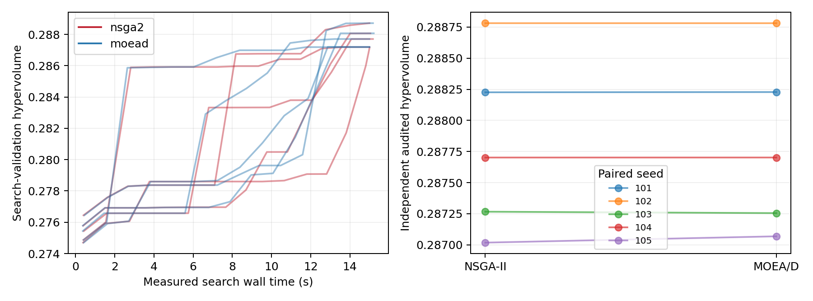
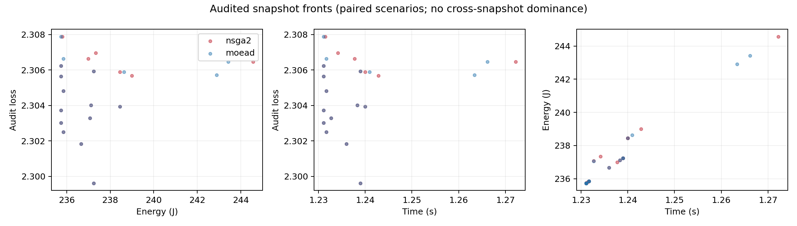

# Báo cáo triển khai Direction A v1: NSGA-II và MOEA/D

**Ngày báo cáo:** 26/10/2026.  
**Đặc tả:** [problem-formulation.md](problem-formulation.md).  
**Trạng thái:** đã triển khai, kiểm thử và chạy 20 lần tối ưu trong hai giao thức so sánh; số liệu dưới đây đọc trực tiếp từ artifact, không phải kết quả minh họa.

## 1. Kết quả chính

Hai thuật toán đã chạy trên cùng bài toán loss–energy–time với CNN và local SGD thực trên Fashion-MNIST. Kết quả pilot cho front audit gần nhau; mức chênh lệch được trình bày theo từng seed và ngân sách ở dưới. Mô hình bắt đầu từ random initialization và chỉ thực thi một vòng, nên báo cáo này xác minh pipeline/solver, chưa chứng minh hội tụ FL hoặc chất lượng mô hình cuối.

Số client của lịch được chọn trong phép so sánh chính: **1**. Chi phí hover và baseline chiếm tỷ trọng lớn, còn loss sau 5 bước local SGD ở checkpoint đầu thay đổi ít. Vì vậy nhiều lịch ít client có lợi trong cấu hình này; cần kiểm tra lại ở checkpoint đã học và phần cứng dị biệt trước khi rút kết luận hệ thống.

## 2. Những gì đã triển khai

| Thành phần | Cài đặt |
| --- | --- |
| Physical evaluator | UAV hover; mask liên kết; uplink effective rate; 6 pha barrier; bandwidth tối thiểu; CPU giải tích; deadline và pin |
| Năng lượng | Client, UAV và coordinator; baseline, hover, tx/rx, aggregate; không tính trùng các nút |
| FL | CNN 105866 tham số; SGD 5 bước, batch 32, lr 0.01; aggregate chuẩn hóa theo trọng số client |
| Objective học | Loss validation thực sau local SGD và aggregation; không dùng gradient score làm fitness |
| Cache | Lazy local-update cache theo snapshot/client/seed; loss cache theo tập client và search/audit protocol |
| Search/audit | SAA 3 seed search, 10 seed audit; split và namespace RNG tách biệt |
| Execution | Khóa lựa chọn trước audit/test; một execution seed riêng; cập nhật model, pin, đồng hồ và report chỉ từ client thực thi |
| Historical guidance | Có code và kiểm thử cho sketch thiếu/cũ, generic fallback; đặt probability=0 trong so sánh chính |
| Output | Candidate ledger/residuals, archive search/audit, manifest, CSV/JSON và hình PNG |

Ba objective được chuẩn hóa bằng scale cố định [2.302585092994046, 1000.0, 5.0]. Hypervolume 3D được tính chính xác cho các vector hữu hạn trong reference box [1.5, 1.0, 1.0]; số audit candidate nằm ngoài box trong dữ liệu chính là 0. Hypervolume càng lớn càng tốt trong cùng snapshot/reference box.

## 3. Hai thuật toán và điều kiện so sánh

**NSGA-II:** nondominated sorting có feasibility dominance, binary tournament theo rank/crowding và elitist environmental selection. Objective có range bằng 0 không góp vào crowding. Đối chiếu mô tả cơ chế ở [tài liệu NSGA-II của pymoo](https://pymoo.org/algorithms/moo/nsga2.html).

**MOEA/D:** simplex weight vectors cho ba mục tiêu; neighborhood trong không gian trọng số; scalarization Tchebycheff với scale cố định và ideal point cập nhật từ nghiệm khả thi; xác suất chọn bố mẹ lân cận 0.9, neighborhood 8, tối đa 2 thay thế mỗi child. Trọng số bằng 0 được thay bằng 1e-6 khi tính scalarization. Feasible được ưu tiên trước infeasible; infeasible so theo tổng vi phạm chuẩn hóa. Đối chiếu framework ở [tài liệu MOEA/D của pymoo](https://pymoo.org/algorithms/moo/moead.html). Constraint handling và mixed-variable variation là lựa chọn của implementation này.

Cả hai được tự triển khai trong [optimizers.py](uavfl/optimizers.py). Chúng dùng cùng uniform crossover cho association, bounded SBX và polynomial mutation cho gene liên tục, add/drop/swap/reassign và decoder tài nguyên trong [operators.py](uavfl/operators.py). Mỗi run bắt đầu với cùng initial genomes và cache rỗng; thứ tự chạy đảo giữa các seed.

Phần cứng dùng CPU, PyTorch threads=1; Torch 2.13.0+cpu, NumPy 2.2.6; Python 3.13.3. Platform: Windows-11-10.0.26200-SP0. [Environment/source hashes](results/equal_time/environment.json) lưu chi tiết tái lập.

## 4. Dữ liệu và ngân sách

Dataset từ [repository Fashion-MNIST chính thức](https://github.com/zalandoresearch/fashion-mnist), kiểm tra MD5 từng file. Dùng 6000 train, 600 search-validation, 600 audit-validation và 1000 test. Ba split đầu không giao nhau và lấy từ training set chính thức; test lấy từ test set chính thức.

Phân chia dirichlet, alpha=0.5, dùng cùng class-to-client probabilities giữa các split. Trọng số quần thể lấy từ kích thước train từng client. Mỗi seed trong [101, 102, 103, 104, 105] xác định data partition, checkpoint và RNG; hai thuật toán ghép cặp trên đúng các yếu tố này.

- 6 client, 2 UAV, tối đa 4 client mỗi vòng; population 28.
- Budget chính: 15 s search, proposal cap 100000; seed bundle là đơn vị evaluation nguyên tử.
- Tính vào search time: initialization evaluation, candidate proposal/decode, lazy cache, training/validation, Pareto selection và trace metrics. Dataset loading, process warm-up và artifact export nằm ngoài.
- Toàn bộ initial population được đánh giá trước evolution; ngân sách phải đủ cho bước này. Chi phí thực được log kể cả nếu có overrun.
- Overrun lớn nhất quan sát: 0.220641 s. Chi phí audit ghi riêng, không cộng vào thời gian vật lý của lịch FL.
- Tất cả energy/cycles/power là synthetic parameters từ đặc tả, chưa được profile trên UAV/thiết bị thật.

## 5. Kết quả ở cùng trần thời gian tìm kiếm

| Chỉ số (mean ± SD qua các seed) | NSGA-II | MOEA/D |
| --- | ---: | ---: |
| Audited HV | 0.28779859 ± 0.00071558 | 0.28780684 ± 0.00070445 |
| Search HV | 0.28776562 ± 0.00065399 | 0.28777607 ± 0.00064256 |
| Search wall time (s) | 15.048 ± 0.076 | 15.081 ± 0.111 |
| CPU time (s) | 14.984 ± 0.078 | 14.994 ± 0.120 |
| Audit wall time (s) | 6.725 ± 1.009 | 6.250 ± 1.621 |
| Số proposals | 1519.6 ± 266.0 | 4495.0 ± 2023.7 |
| Tập client search duy nhất | 49.2 ± 1.6 | 45.0 ± 4.4 |
| Số update cache misses | 18.0 ± 0.0 | 18.0 ± 0.0 |
| Tỷ lệ test accuracy của lịch đã chọn | 0.0990 ± 0.0023 | 0.0979 ± 0.0049 |
| Test loss của lịch đã chọn | 2.30536 ± 0.00161 | 2.30514 ± 0.00130 |
| Năng lượng lịch đã chọn (J) | 235.773 ± 0.050 | 235.782 ± 0.060 |
| Thời gian vật lý lịch đã chọn (s) | 1.23130 ± 0.00026 | 1.23134 ± 0.00032 |

| Seed | HV NSGA-II | HV MOEA/D | ΔHV (NSGA-II − MOEA/D) | Search s: NSGA-II / MOEA/D |
| ---: | ---: | ---: | ---: | ---: |
| 101 | 0.288225534 | 0.288227564 | -0.000002030 | 15.047 / 15.221 |
| 102 | 0.288780784 | 0.288780584 | +0.000000200 | 15.003 / 15.182 |
| 103 | 0.287266619 | 0.287255250 | +0.000011369 | 15.003 / 15.000 |
| 104 | 0.287701726 | 0.287701880 | -0.000000153 | 15.180 / 15.001 |
| 105 | 0.287018288 | 0.287068926 | -0.000050637 | 15.007 / 15.000 |

Chênh lệch HV ghép cặp trung bình (NSGA-II − MOEA/D): **-0.000008250**. Khoảng bootstrap percentile 95% mô tả: [-0.000030444, +0.000006455]; kiểm định đổi dấu ghép cặp hai phía, liệt kê đủ 32 tổ hợp: p=0.6875. Sai khác HV dưới 1e-9 được xem là 0 khi suy luận. Với 5 cặp, đây là thống kê thăm dò; không đủ để kết luận ưu thế tổng quát.



Đồ thị trái dùng search-validation; đồ thị phải dùng audit-validation độc lập. Không diễn giải search HV là audited HV. Các cặp seed là đơn vị so sánh; candidate cùng snapshot không phải replicate độc lập.



Hình gộp các seed để xem hình dạng đánh đổi; không tính dominance giữa các checkpoint khác nhau.

[Summary CSV](results/equal_time/summary.csv) · [Summary JSON](results/equal_time/summary.json) · [Audited fronts](results/equal_time/fronts.csv) · [Search traces](results/equal_time/traces.csv)

## 6. Đối chiếu bổ sung ở cùng trần số đề xuất

Cấu hình [pilot](results/pilot/config.json) dùng trần 30 s và 10000 proposals. Các run đã chạm giới hạn proposals; đây là phép so sánh theo số đề xuất, không gọi là cùng thời gian thực.

| Chỉ số (mean ± SD qua các seed) | NSGA-II | MOEA/D |
| --- | ---: | ---: |
| Audited HV | 0.28780916 ± 0.00070231 | 0.28780688 ± 0.00070452 |
| Search HV | 0.28777624 ± 0.00064259 | 0.28777618 ± 0.00064267 |
| Search wall time (s) | 22.276 ± 1.015 | 18.238 ± 1.416 |
| CPU time (s) | 22.209 ± 0.997 | 18.159 ± 1.389 |
| Audit wall time (s) | 6.456 ± 1.213 | 6.243 ± 1.789 |
| Số proposals | 10000.0 ± 0.0 | 10000.0 ± 0.0 |
| Tập client search duy nhất | 50.8 ± 2.8 | 45.6 ± 5.0 |
| Số update cache misses | 18.0 ± 0.0 | 18.0 ± 0.0 |
| Tỷ lệ test accuracy của lịch đã chọn | 0.0979 ± 0.0049 | 0.0979 ± 0.0049 |
| Test loss của lịch đã chọn | 2.30514 ± 0.00130 | 2.30514 ± 0.00130 |
| Năng lượng lịch đã chọn (J) | 235.782 ± 0.061 | 235.782 ± 0.061 |
| Thời gian vật lý lịch đã chọn (s) | 1.23134 ± 0.00032 | 1.23134 ± 0.00032 |

| Seed | HV NSGA-II | HV MOEA/D | ΔHV (NSGA-II − MOEA/D) | Search s: NSGA-II / MOEA/D |
| ---: | ---: | ---: | ---: | ---: |
| 101 | 0.288227565 | 0.288227565 | +0.000000000 | 22.846 / 19.952 |
| 102 | 0.288780798 | 0.288780798 | +0.000000000 | 21.879 / 18.607 |
| 103 | 0.287266619 | 0.287255250 | +0.000011369 | 21.728 / 16.069 |
| 104 | 0.287701880 | 0.287701880 | +0.000000000 | 23.742 / 17.938 |
| 105 | 0.287068926 | 0.287068926 | +0.000000000 | 21.187 / 18.624 |

Chênh lệch HV ghép cặp trung bình (NSGA-II − MOEA/D): **+0.000002274**. Khoảng bootstrap percentile 95% mô tả: [+0.000000000, +0.000006821]; kiểm định đổi dấu ghép cặp hai phía, liệt kê đủ 32 tổ hợp: p=1.0000. Sai khác HV dưới 1e-9 được xem là 0 khi suy luận. Với 5 cặp, đây là thống kê thăm dò; không đủ để kết luận ưu thế tổng quát.

[Summary CSV](results/pilot/summary.csv) · [Đồ thị HV](results/pilot/hypervolume.png)

## 7. Kiểm thử và kiểm tra kết quả

Đã qua **14 kiểm thử**; log tại [verification.txt](results/verification.txt).

Các nhóm kiểm tra: ledger và timeline; inactive mask/UAV rỗng vẫn hover; rate đơn điệu; deadline và pin; CPU reduction; parameter count; seed/cache determinism; hierarchical/flat aggregation; audit namespace; missing/stale-history guide; guided swap giữ client chưa biết; exact HV; dominance/crowding; simplex weights; cả NSGA-II và MOEA/D dừng đúng proposal budget.

Artifact của mỗi run có assignment, bandwidth, CPU, từng pha thời gian, năng lượng từng nút, raw residuals và loss replicates trong candidates.jsonl.gz. selected.json lưu lựa chọn đã khóa trước audit và pin/đồng hồ sau thực thi.

Biên bản xác minh của lần bàn giao gốc đã đối chiếu source hashes, tái tính audited HV và rà **130073 candidate records**, trong đó 129756 khả thi có ledger/timeline/mean loss nhất quán. [Biên bản kiểm tra artifact](results/artifact-verification.json). Khi chạy lại thí nghiệm mới, biên bản này vẫn là bằng chứng của lần bàn giao gốc, không tự xác nhận dữ liệu mới.

Đã kiểm tra tích hợp thêm **6 vòng** trong hai episode, mỗi thuật toán 3 vòng, với guidance probability=0.5 và cấu hình nhỏ riêng tại [episode_smoke.json](configs/episode_smoke.json). Pin/năng lượng/đồng hồ tiến đúng, history chuyển từ rỗng sang có báo cáo; guided swap được sử dụng khi đủ thông tin. Đây là smoke test của lần bàn giao, không dùng để xếp hạng thuật toán. [Kết quả nhiều vòng](results/episode_smoke/summary.csv).


## 8. Giới hạn và cách đọc kết quả

1. Đây là pilot một vòng từ model ngẫu nhiên. Test accuracy thấp ở giai đoạn này không đo convergence của FL nhiều vòng; không chọn hyperparameter để làm đẹp test.
2. 6 client có ít tập con; lazy cache khiến bài toán học nhanh được khám phá. Khi hai solver gần cùng front, không thể suy ra chúng tương đương trên mạng lớn.
3. Guided mutation đã có code nhưng không được kích hoạt trong phép so sánh chính. Chưa có kết luận về đóng góp set-aware.
4. Các hệ số phần cứng hiện là scalar chung cho từng nhóm nút; chưa hỗ trợ vectors DVFS/power dị biệt từng client. Vị trí, dữ liệu, association và trạng thái pin vẫn khác nhau.
5. Chưa triển khai dynamic channel, outage/retransmission, multi-fidelity, adaptive probing hoặc tối ưu quỹ đạo. Các phép rút gọn được giới hạn ở static-hover model.
6. Energy/time là chi phí thực thi mô phỏng theo mô hình; search/audit wall time là số đo máy chạy. Chúng có đơn vị và phạm vi hạch toán khác nhau.
7. Có tùy chọn chạy nhiều vòng qua --rounds, nhưng số liệu chính ở đây dùng một vòng. Khi không tìm được lịch khả thi, runner dừng với trạng thái lỗi rõ ràng, chưa tự động thực hiện recovery mạng.
8. Bootstrap và kiểm định đổi dấu với 5 cặp chỉ có tính thăm dò. Cần thêm checkpoint, partitions, quy mô mạng và paired runs trước khi kết luận thuật toán vượt trội.

## 9. Tái lập

Từ thư mục src/v1:

```powershell
python -m pip install -r requirements.txt
python -m unittest discover -s tests -v
python run.py --config configs/equal_time.json --output results/reproduce_equal_time --seeds 101 102 103 104 105 --download
python run.py --config configs/pilot.json --output results/reproduce_proposals --seeds 101 102 103 104 105
python make_report.py --results results/reproduce_equal_time --secondary results/reproduce_proposals --output report-reproduced.md
```

Wall-time stopping có thể làm số candidate khác giữa các máy/lần chạy; seed và RNG cố định tái lập FL updates và fitness của cùng candidate. Khi kiểm tra bit-level replay theo số đề xuất, dùng proposal budget cố định và cấp đủ wall-time.

Cấu hình đầy đủ hơn nằm ở [configs/full.json](configs/full.json), chưa được dùng để tạo số liệu báo cáo này. Bước tiếp theo phù hợp là checkpoint đã huấn luyện, phần cứng dị biệt, quy mô 20/50 client và ablation guidance, với cùng giao thức audit.
